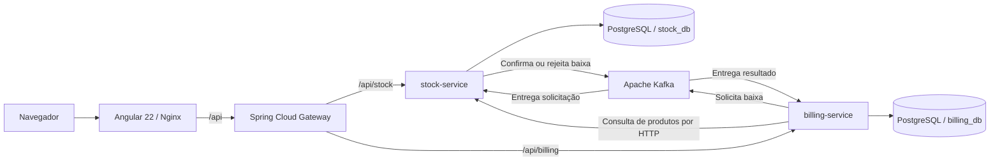

# invoice-microservices

Projeto de portfólio para cadastrar produtos e clientes, acompanhar movimentações de estoque e fechar notas fiscais internas. Ao selecionar **Imprimir**, o Faturamento inicia o fechamento assíncrono. A nota fecha quando o Estoque confirma a baixa. Se faltar saldo, a nota volta a ficar aberta, com o motivo disponível para correção.

A `v0.1.0` é uma demonstração local sem login. As notas representam documentos internos simplificados para demonstrar o fluxo, sem integração com a SEFAZ.

## Arquitetura



Os serviços de domínio usam Java 21, Spring Boot 4 e arquitetura hexagonal, cada um com seu banco PostgreSQL. Quando uma mudança de estado gera um evento da Saga, o serviço grava a mudança e o evento na Outbox em uma única transação. O Kafka transporta os eventos, os consumidores tratam reentregas de forma idempotente e o bloqueio otimista protege o saldo de baixas concorrentes. A interface consulta o status até o fechamento, a rejeição ou o limite do acompanhamento automático.

## Execução local

Com Docker em execução e Docker Compose v2 disponível, rode os comandos abaixo no terminal.

```sh
git clone https://github.com/Elias-Costa/invoice-microservices.git
cd invoice-microservices
docker compose up --build -d --wait
docker compose ps --all
```

Abra [localhost:4200](http://localhost:4200). Os perfis `docker,demo` carregam os dados de demonstração no primeiro uso. O Compose usa os valores padrão documentados em [`.env.example`](.env.example).

| Componente | Endereço local | Uso |
|---|---|---|
| Frontend | `http://localhost:4200` | Interface Angular e proxy de `/api` |
| Gateway | `http://localhost:8080` | Entrada HTTP da API |
| Estoque | `http://localhost:8081` | Acesso direto ao `stock-service` |
| Faturamento | `http://localhost:8082` | Acesso direto ao `billing-service` |
| PostgreSQL do Estoque | `127.0.0.1:5433` | `stock_db` |
| PostgreSQL do Faturamento | `127.0.0.1:5434` | `billing_db` |
| Kafka | `localhost:9092` | Broker para clientes no host |
| Kafka UI | `http://localhost:8090` | Inspeção de tópicos, disponível com o perfil `tools` |

Os serviços persistentes da stack padrão ficam `healthy`. O contêiner `kafka-init` termina com código `0` após preparar o volume. Para iniciar a Kafka UI, use `docker compose --profile tools up -d kafka-ui`. Para encerrar preservando os dados, use `docker compose --profile tools down`.

## Demonstração

Em um banco recém-populado, há 12 produtos, 5 clientes e 5 notas. A nota `000001` está fechada, a `000002` está cancelada e as `000003` a `000005` estão abertas. Use a **Oficina Mecânica Silva Ltda** como cliente de exemplo. A primeira nota criada após o seed recebe o número `000006`. [Dados de demonstração](docs/modelo-de-dados.md#13-dados-de-demonstração-seed)

Pela interface, cadastre um produto com saldo inicial 10. Em **Notas fiscais**, crie uma nota para o cliente de exemplo com 2 unidades do produto. Na tela de detalhe, selecione **Imprimir** e aguarde o status **Fechada**. Em **Produtos**, abra o histórico do produto e confira a baixa de 2 unidades e o saldo 8.

Para executar os cinco cenários automatizados, use Bash, `curl` e `jq` a partir da raiz com a stack no ar e os dados do seed intactos. Cada script imprime `PASS` ou `FAIL`. Os roteiros alteram os dados da demonstração. Para repeti-los com os saldos iniciais, encerre a instância em uso com `docker compose down`, exporte `COMPOSE_PROJECT_NAME` com um novo nome e suba a stack. Rode os scripts na mesma sessão.

| Cenário | Comando | Resultado esperado |
|---|---|---|
| Fluxo feliz | `bash scripts/demo/happy-path.sh` | A nota fecha e o saldo de `ARR-M6` passa de 1.000 para 950, com uma única baixa. |
| Saldo insuficiente | `bash scripts/demo/insufficient-stock.sh` | A nota `000005` volta a `OPEN` com o motivo e preserva os saldos dos dois itens. |
| Concorrência | `bash scripts/demo/concurrent-prints.sh` | Só uma das notas `000003` e `000004` fecha. O saldo de `TRE-5M` passa de 1 para 0, sem baixa parcial na nota rejeitada. |
| Idempotência | `bash scripts/demo/idempotency.sh` | Dois envios com a mesma `Idempotency-Key` recebem o mesmo documento e criam uma única nota. |
| Queda do Estoque | `bash scripts/demo/stock-outage.sh` | O roteiro para o Estoque, imprime uma nota já criada e verifica `PROCESSING`. Após religar o serviço, a nota fecha automaticamente e baixa uma unidade de `CHV-FEN-6`. |

## Verificação local

O backend requer JDK 21 e Docker em execução para os testes com Testcontainers. Para o frontend, a imagem de build usa Node.js 22. Rode os comandos abaixo a partir da raiz.

```sh
(cd backend && ./mvnw -q verify)
npm --prefix frontend ci
npm --prefix frontend run lint
npm --prefix frontend test -- --watch=false
npm --prefix frontend run build
```

No PowerShell, rode `.\mvnw.cmd -q verify` dentro de `backend/`. Use `npm.cmd` no lugar de `npm` se a política de execução do PowerShell bloquear o script do npm.

## Como este projeto foi construído

O autor definiu os requisitos, a arquitetura e as decisões de projeto. A implementação foi feita com agentes de código sob um processo documentado, com verificação local e revisão humana antes de cada commit. [Instruções de implementação](AGENTS.md) · [Registro de decisões](docs/decisions.md) · [Guia de trabalho](docs/guia-trabalho-com-agente.md)

## Evoluções possíveis

A F1 corresponde à entrega de portfólio. A F2 reúne propostas de autenticação com Keycloak, PDF, histórico visível da nota e observabilidade. A F3 reúne propostas de CI, testes ponta a ponta e reconciliação de notas em processamento. [Decisão de escopo (D-029)](docs/decisions.md#d-029--encerramento-da-implementação-na-f1) · [Plano de entrega](docs/requisitos.md#11-plano-de-entrega)

## Documentação

- [Requisitos](docs/requisitos.md)
- [Modelo de dados](docs/modelo-de-dados.md)
- [Decisão sobre as versões da plataforma](docs/adr/0001-versoes-da-plataforma.md)
