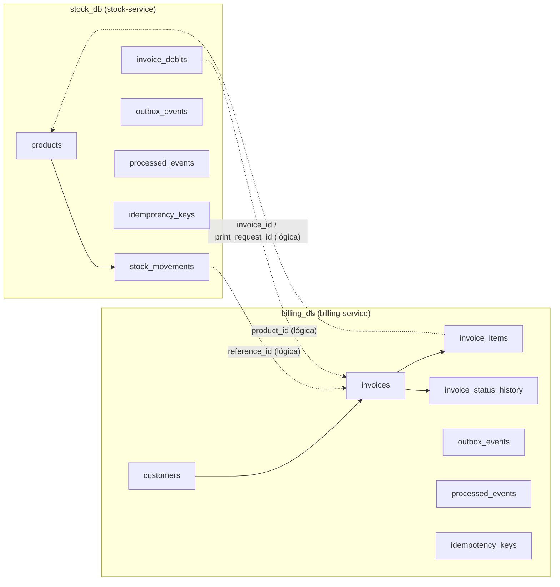
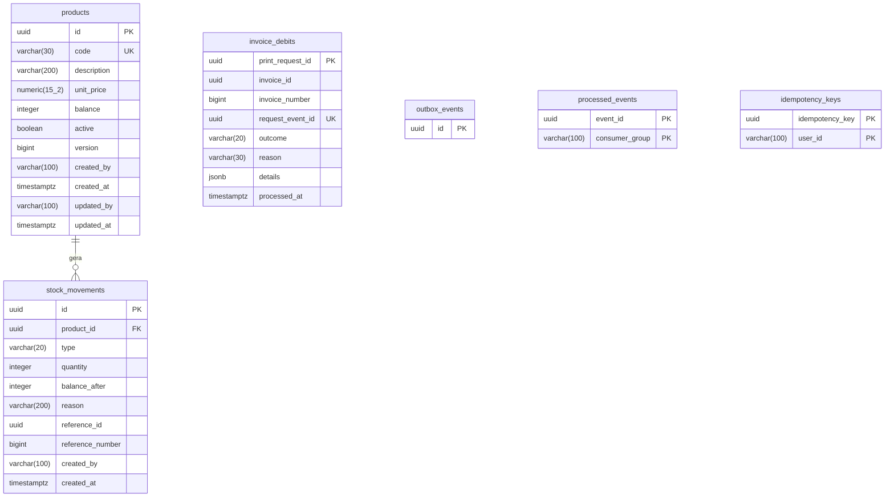
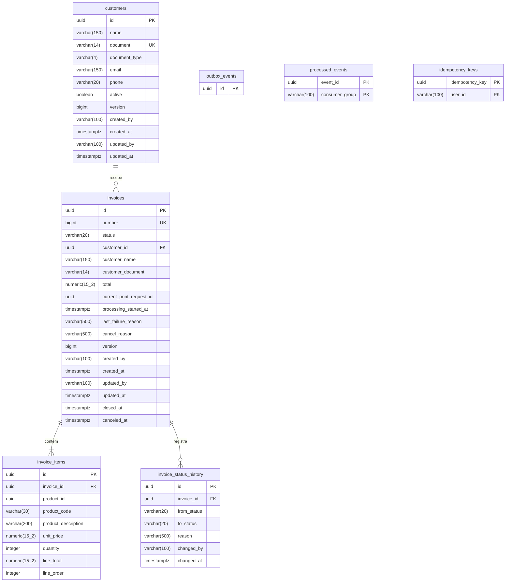

# invoice-microservices — Modelo de Dados

| Campo | Valor |
|---|---|
| Projeto | `invoice-microservices` |
| Versão do documento | 1.0 |
| Data | 2026-09-12 |
| Status | Aprovado para desenvolvimento |
| SGBD | PostgreSQL 16 |
| Documentos relacionados | [Documento de Requisitos](requisitos.md) (§8.5 traz o resumo; este documento é a referência detalhada) |

---

## Sumário

1. [Introdução](#1-introdução)
2. [Princípios e convenções](#2-princípios-e-convenções)
3. [Visão geral](#3-visão-geral)
4. [Banco `stock_db` (stock-service)](#4-banco-stock_db-stock-service)
5. [Banco `billing_db` (billing-service)](#5-banco-billing_db-billing-service)
6. [Tabelas técnicas comuns](#6-tabelas-técnicas-comuns)
7. [Referências entre serviços](#7-referências-entre-serviços)
8. [Invariantes e onde são garantidas](#8-invariantes-e-onde-são-garantidas)
9. [Mapeamento domínio ↔ persistência](#9-mapeamento-domínio--persistência)
10. [Migrações Flyway](#10-migrações-flyway)
11. [Padrões de acesso, índices e volumetria](#11-padrões-de-acesso-índices-e-volumetria)
12. [Retenção e limpeza](#12-retenção-e-limpeza)
13. [Dados de demonstração (seed)](#13-dados-de-demonstração-seed)
14. [Evolução futura](#14-evolução-futura)
15. [Apêndice A — DDL de referência](#apêndice-a--ddl-de-referência)

---

## 1. Introdução

### 1.1 Propósito

Este documento define o modelo de dados físico e lógico do sistema: bancos, tabelas, colunas, tipos, constraints, índices, sequences, relacionamentos (físicos e lógicos entre serviços), mapeamento para o domínio Java, plano de migrações e dados de demonstração. É a fonte de verdade para as migrações Flyway e para as entidades JPA.

### 1.2 Escopo

Dois bancos PostgreSQL independentes, um por microsserviço:

| Banco | Serviço | Conteúdo |
|---|---|---|
| `stock_db` | `stock-service` | Produtos, movimentações de estoque, registro de baixas por nota, tabelas técnicas |
| `billing_db` | `billing-service` | Clientes, notas fiscais, itens, histórico de status, tabelas técnicas |

Keycloak usa seu próprio banco (H2 embutido em dev ou PostgreSQL dedicado); não faz parte deste modelo.

---

## 2. Princípios e convenções

### 2.1 Database-per-service

Cada serviço é dono exclusivo do seu banco. Não existem foreign keys físicas entre bancos; referências cruzadas são **lógicas** (UUID + snapshot) e a consistência é mantida por eventos ([§7](#7-referências-entre-serviços)). Nenhum serviço recebe credenciais do banco do outro.

### 2.2 Nomenclatura

| Elemento | Convenção | Exemplo |
|---|---|---|
| Tabela | `snake_case`, plural | `stock_movements` |
| Coluna | `snake_case`, singular | `unit_price` |
| Chave primária | `pk_<tabela>` | `pk_products` |
| Chave estrangeira | `fk_<tabela>_<referência>` | `fk_invoice_items_invoice` |
| Unique | `uk_<tabela>_<colunas>` | `uk_products_code` |
| Check | `ck_<tabela>_<assunto>` | `ck_products_balance` |
| Índice | `ix_<tabela>_<colunas>`; único parcial: `ux_…` | `ix_invoices_status_created` |
| Sequence | `<assunto>_seq` | `invoice_number_seq` |
| Enumerações | `varchar` + `CHECK`, valores em `UPPER_SNAKE` | `'INVOICE_DEBIT'` |

Nomes de tabelas e colunas em inglês; comentários (`COMMENT ON`) em português.

### 2.3 Tipos padrão

| Conceito | Tipo PostgreSQL | Tipo Java | Observação |
|---|---|---|---|
| Identificador | `uuid` | `java.util.UUID` | Gerado pela aplicação (v4) no construtor do agregado |
| Número sequencial | `bigint` + `sequence` | `long` | Somente `invoices.number` |
| Dinheiro | `numeric(15,2)` | `BigDecimal` (VO `Money`) | Escala 2, `HALF_UP`; nunca `float/double` |
| Quantidade | `integer` | `int` (VO `Quantity`) | Unidades inteiras |
| Texto curto | `varchar(n)` | `String` | Limite explícito sempre |
| Texto longo | `text` | `String` | Apenas `last_error` em outbox |
| Data/hora | `timestamptz` | `java.time.Instant` | Sempre UTC; JDBC `hibernate.jdbc.time_zone=UTC` |
| Booleano | `boolean` | `boolean` | `NOT NULL` com default |
| Enumeração | `varchar(n)` + `CHECK` | `enum` Java | `@Enumerated(EnumType.STRING)`; sem tipo `ENUM` do PG (evolução mais simples) |
| Documento JSON | `jsonb` | `String`/`JsonNode` | Payload de eventos, respostas idempotentes |
| Versão otimista | `bigint` | `long` | `@Version` |

### 2.4 Identificadores

- PK sempre `uuid`, gerado pela aplicação (`UUID.randomUUID()`), nunca pelo banco — o agregado nasce com identidade antes de persistir, o que simplifica outbox e testes.
- UUID v7 (ordenado por tempo) é uma evolução planejada ([§14](#14-evolução-futura)); v4 é suficiente para a volumetria do projeto.
- `invoices.number` é a chave **de negócio** (visível ao usuário); o `id` continua sendo a chave técnica.

### 2.5 Auditoria e timestamps

Todas as tabelas de agregados possuem:

| Coluna | Tipo | Regra |
|---|---|---|
| `created_at` | `timestamptz NOT NULL DEFAULT now()` | Preenchida pelo banco ou por `@CreationTimestamp` |
| `created_by` | `varchar(100) NOT NULL` | `preferred_username` do JWT; `system` para operações internas (consumidores Kafka, jobs) |
| `updated_at` | `timestamptz` | `@UpdateTimestamp` |
| `updated_by` | `varchar(100)` | idem `created_by` |

Tabelas append-only (`stock_movements`, `invoice_status_history`, `processed_events`) têm apenas `created_*`/`*_at`.

Na F1, as operações HTTP de produtos do Estoque e de clientes do Faturamento registram `anonymous` na auditoria. No cadastro de produto, o produto e a movimentação `INITIAL` recebem o mesmo autor.

### 2.6 Exclusão lógica

`products` e `customers` nunca são apagados; `active = false` marca inativação. Não há coluna `deleted_at` — o conceito de negócio é "inativo", não "excluído". Tabelas de fatos (`invoices`, `stock_movements`) nunca são apagadas.

### 2.7 Controle de concorrência

Agregados mutáveis (`products`, `customers`, `invoices`) têm coluna `version bigint` gerenciada por JPA `@Version` (locking otimista, ADR-008). Clientes REST enviam `version` em `PUT`; divergência → `409 optimistic-lock-conflict`. Consumidores Kafka fazem retry local em `OptimisticLockException`.

### 2.8 Snapshots (desnormalização intencional)

Dados que precisam ficar congelados no tempo são copiados, não referenciados:

| Origem | Destino | Motivo |
|---|---|---|
| `stock.products.code/description/unit_price` | `billing.invoice_items.product_*` / `unit_price` | Nota não muda quando o produto muda (RN-18); sem chamada ao Estoque para exibir uma nota |
| `billing.customers.name/document` | `billing.invoices.customer_*` | Nota reflete o cliente na data de emissão (RN-21) |
| `billing.invoices.number` | `stock.stock_movements.reference_number` | Exibir "NF 000123" no histórico sem consultar o Faturamento |

`invoices.total` e `invoice_items.line_total` são derivados e persistidos para listagem/ordenação; a consistência é garantida por `CHECK` e pelo domínio.

---

## 3. Visão geral



Linhas contínuas: foreign keys físicas. Linhas tracejadas: referências lógicas entre bancos, sem FK, mantidas por eventos e snapshots.

---

## 4. Banco `stock_db` (stock-service)

### 4.1 Diagrama ER



### 4.2 `products`

Agregado raiz **Product**. Um registro por produto cadastrado.

| Coluna | Tipo | Null | Default | Descrição |
|---|---|---|---|---|
| `id` | `uuid` | não | — | Identificador técnico |
| `code` | `varchar(30)` | não | — | Código de negócio, único, maiúsculas, imutável (RN-01) |
| `description` | `varchar(200)` | não | — | Nome/descrição do produto |
| `unit_price` | `numeric(15,2)` | não | — | Preço unitário de venda, ≥ 0 |
| `balance` | `integer` | não | `0` | Saldo atual em estoque, ≥ 0 (RN-02); alterado apenas via movimentação (RN-05) |
| `active` | `boolean` | não | `true` | Exclusão lógica (RN-03, RN-04) |
| `version` | `bigint` | não | `0` | Locking otimista |
| `created_by` | `varchar(100)` | não | — | Usuário criador |
| `created_at` | `timestamptz` | não | `now()` | |
| `updated_by` | `varchar(100)` | sim | — | |
| `updated_at` | `timestamptz` | sim | — | |

**Constraints**

| Nome | Tipo | Definição |
|---|---|---|
| `pk_products` | PK | `(id)` |
| `uk_products_code` | UNIQUE | `(code)` — a aplicação normaliza para maiúsculas e sem espaços antes de gravar |
| `ck_products_code_format` | CHECK | `code ~ '^[A-Z0-9][A-Z0-9._-]{0,29}$'` |
| `ck_products_unit_price` | CHECK | `unit_price >= 0` |
| `ck_products_balance` | CHECK | `balance >= 0` — última linha de defesa contra saldo negativo |

**Índices**

| Nome | Definição | Uso |
|---|---|---|
| `ix_products_active_code` | `(active, code)` | Listagem padrão (`active = true` ordenada por código) |
| `ix_products_search_trgm` | `GIN (code gin_trgm_ops, description gin_trgm_ops)` | Busca `ILIKE '%termo%'` (RF-PRD-02); requer extensão `pg_trgm` |

### 4.3 `stock_movements`

Agregado **StockMovement**, append-only. Registro imutável de toda alteração de saldo (RN-05).

| Coluna | Tipo | Null | Default | Descrição |
|---|---|---|---|---|
| `id` | `uuid` | não | — | |
| `product_id` | `uuid` | não | — | FK → `products.id` |
| `type` | `varchar(20)` | não | — | `INITIAL`, `INBOUND`, `OUTBOUND`, `INVOICE_DEBIT` |
| `quantity` | `integer` | não | — | Quantidade movimentada (sempre positiva; o sinal é dado por `type`). `INITIAL` admite 0 |
| `balance_after` | `integer` | não | — | Saldo do produto imediatamente após a movimentação |
| `reason` | `varchar(200)` | sim | — | Motivo informado pelo usuário; obrigatório para `INBOUND`/`OUTBOUND` |
| `reference_id` | `uuid` | sim | — | `invoices.id` (lógico) quando `INVOICE_DEBIT`; nulo nos demais |
| `reference_number` | `bigint` | sim | — | `invoices.number` (snapshot) para exibição |
| `created_by` | `varchar(100)` | não | — | Usuário ou `requestedBy` do evento |
| `created_at` | `timestamptz` | não | `now()` | |

**Constraints**

| Nome | Tipo | Definição |
|---|---|---|
| `pk_stock_movements` | PK | `(id)` |
| `fk_stock_movements_product` | FK | `(product_id) → products(id)` — sem `ON DELETE` (produtos não são apagados) |
| `ck_stock_movements_type` | CHECK | `type IN ('INITIAL','INBOUND','OUTBOUND','INVOICE_DEBIT')` |
| `ck_stock_movements_quantity` | CHECK | `(type = 'INITIAL' AND quantity >= 0) OR (type <> 'INITIAL' AND quantity > 0)` |
| `ck_stock_movements_balance_after` | CHECK | `balance_after >= 0` |
| `ck_stock_movements_reference` | CHECK | `(type = 'INVOICE_DEBIT') = (reference_id IS NOT NULL AND reference_number IS NOT NULL)` |
| `ck_stock_movements_reason` | CHECK | `type IN ('INITIAL','INVOICE_DEBIT') OR reason IS NOT NULL` |

**Índices**

| Nome | Definição | Uso |
|---|---|---|
| `ix_stock_movements_product_created` | `(product_id, created_at DESC)` | Histórico do produto paginado (RF-STK-02) |
| `ux_stock_movements_invoice_product` | `UNIQUE (reference_id, product_id) WHERE type = 'INVOICE_DEBIT'` | Uma baixa por produto por nota — defesa extra contra dupla baixa (RN-17) |
| `ix_stock_movements_reference` | `(reference_id) WHERE reference_id IS NOT NULL` | Localizar movimentações de uma nota |

### 4.4 `invoice_debits`

Registro (log da Saga) de cada **solicitação de baixa** processada pelo Estoque. Garante que a mesma solicitação nunca seja aplicada duas vezes e permite reemitir o mesmo resultado quando a solicitação chega repetida (reentrega Kafka, republicação pelo job de reconciliação).

| Coluna | Tipo | Null | Default | Descrição |
|---|---|---|---|---|
| `print_request_id` | `uuid` | não | — | Identificador da tentativa de impressão, gerado pelo Faturamento a cada `POST /print`; chave de idempotência de negócio |
| `invoice_id` | `uuid` | não | — | `invoices.id` (lógico) |
| `invoice_number` | `bigint` | não | — | Snapshot para diagnóstico |
| `request_event_id` | `uuid` | não | — | `id` do evento `stock.debit-requested` que originou o processamento |
| `outcome` | `varchar(20)` | não | — | `CONFIRMED` ou `REJECTED` |
| `reason` | `varchar(30)` | sim | — | `INSUFFICIENT_STOCK`, `PRODUCT_INACTIVE`, `PRODUCT_NOT_FOUND` — obrigatório se `REJECTED` |
| `details` | `jsonb` | sim | — | Itens afetados: `[{productId, productCode, requested, available}]` ou `[{productId, quantity, balanceAfter}]` |
| `processed_at` | `timestamptz` | não | `now()` | |

**Constraints e índices**

| Nome | Tipo | Definição |
|---|---|---|
| `pk_invoice_debits` | PK | `(print_request_id)` |
| `uk_invoice_debits_request_event` | UNIQUE | `(request_event_id)` |
| `ck_invoice_debits_outcome` | CHECK | `outcome IN ('CONFIRMED','REJECTED')` |
| `ck_invoice_debits_reason` | CHECK | `(outcome = 'REJECTED') = (reason IS NOT NULL)` |
| `ux_invoice_debits_confirmed` | UNIQUE parcial | `(invoice_id) WHERE outcome = 'CONFIRMED'` — **no máximo uma baixa confirmada por nota** (RN-17); tentativas rejeitadas podem se repetir (nota volta a `OPEN`, é editada e reimpressa com novo `print_request_id`) |
| `ix_invoice_debits_invoice` | índice | `(invoice_id, processed_at DESC)` |

**Fluxo no consumidor** (pseudocódigo):

```
receber stock.debit-requested(eventId, printRequestId, invoiceId, items)
  se processed_events contém (eventId, 'stock-service') → ignorar (reentrega do mesmo evento)
  se invoice_debits contém printRequestId → republicar o resultado gravado; registrar eventId; encerrar
  TX:
    para cada item: carregar produto (@Version), validar ativo e saldo, debitar, inserir stock_movement
    se algum item falhar → rollback parcial (nenhuma baixa), outcome = REJECTED
    inserir invoice_debits(printRequestId, outcome, …)
    inserir outbox_events(stock.debit-confirmed | stock.debit-rejected)
    inserir processed_events(eventId)
  commit
```

### 4.5 Tabelas técnicas

`outbox_events`, `processed_events`, `idempotency_keys` — definidas em [§6](#6-tabelas-técnicas-comuns).

---

## 5. Banco `billing_db` (billing-service)

### 5.1 Diagrama ER



### 5.2 `customers`

Agregado raiz **Customer**.

| Coluna | Tipo | Null | Default | Descrição |
|---|---|---|---|---|
| `id` | `uuid` | não | — | |
| `name` | `varchar(150)` | não | — | Nome ou razão social |
| `document` | `varchar(14)` | não | — | CPF (11 dígitos) ou CNPJ (14 dígitos), **somente dígitos**, único, imutável (RN-20) |
| `document_type` | `varchar(4)` | não | — | `CPF` ou `CNPJ` (derivado do tamanho; persistido para filtros/exibição) |
| `email` | `varchar(150)` | sim | — | Formato validado na aplicação |
| `phone` | `varchar(20)` | sim | — | Somente dígitos com DDI/DDD; máscara na UI |
| `active` | `boolean` | não | `true` | RN-20 |
| `version` | `bigint` | não | `0` | |
| `created_by` / `created_at` / `updated_by` / `updated_at` | — | — | — | Auditoria ([§2.5](#25-auditoria-e-timestamps)) |

**Constraints**

| Nome | Tipo | Definição |
|---|---|---|
| `pk_customers` | PK | `(id)` |
| `uk_customers_document` | UNIQUE | `(document)` |
| `ck_customers_document_digits` | CHECK | `document ~ '^[0-9]{11}$' OR document ~ '^[0-9]{14}$'` |
| `ck_customers_document_type` | CHECK | `(document_type = 'CPF' AND length(document) = 11) OR (document_type = 'CNPJ' AND length(document) = 14)` |

A validação de **dígitos verificadores** é responsabilidade do domínio (VO `Document`); o banco garante apenas formato e unicidade.

**Índices**

| Nome | Definição | Uso |
|---|---|---|
| `ix_customers_active_name` | `(active, name)` | Listagem padrão |
| `ix_customers_search_trgm` | `GIN (name gin_trgm_ops)` | Busca por nome; busca por documento usa `uk_customers_document` (prefixo) |

### 5.3 `invoices`

Agregado raiz **Invoice**.

| Coluna | Tipo | Null | Default | Descrição |
|---|---|---|---|---|
| `id` | `uuid` | não | — | |
| `number` | `bigint` | não | `nextval('invoice_number_seq')` | Numeração sequencial de negócio (RN-06); exibida com 6 dígitos (`000123`) |
| `status` | `varchar(20)` | não | — | `OPEN`, `PROCESSING`, `CLOSED`, `CANCELED` ([máquina de estados](requisitos.md#5-máquina-de-estados-da-nota-fiscal)) |
| `customer_id` | `uuid` | não | — | FK → `customers.id` |
| `customer_name` | `varchar(150)` | não | — | Snapshot (RN-21) |
| `customer_document` | `varchar(14)` | não | — | Snapshot |
| `total` | `numeric(15,2)` | não | `0` | Soma de `invoice_items.line_total` (RN-19) |
| `current_print_request_id` | `uuid` | sim | — | Identificador da tentativa de impressão em curso/última; enviado no evento e devolvido no resultado; resultados com id diferente são ignorados (obsoletos) |
| `processing_started_at` | `timestamptz` | sim | — | Momento da transição para `PROCESSING`; base do job de reconciliação (RF-PRT-06) |
| `last_failure_reason` | `varchar(500)` | sim | — | Motivo legível da última rejeição (RF-PRT-04); limpo ao fechar |
| `cancel_reason` | `varchar(500)` | sim | — | Motivo do cancelamento (RF-INV-05) |
| `version` | `bigint` | não | `0` | |
| `created_by` / `created_at` / `updated_by` / `updated_at` | — | — | — | Auditoria |
| `closed_at` | `timestamptz` | sim | — | Preenchido ao fechar |
| `canceled_at` | `timestamptz` | sim | — | Preenchido ao cancelar |

**Constraints**

| Nome | Tipo | Definição |
|---|---|---|
| `pk_invoices` | PK | `(id)` |
| `uk_invoices_number` | UNIQUE | `(number)` |
| `fk_invoices_customer` | FK | `(customer_id) → customers(id)` |
| `ck_invoices_status` | CHECK | `status IN ('OPEN','PROCESSING','CLOSED','CANCELED')` |
| `ck_invoices_total` | CHECK | `total >= 0` |
| `ck_invoices_closed` | CHECK | `(status = 'CLOSED') = (closed_at IS NOT NULL)` |
| `ck_invoices_canceled` | CHECK | `(status = 'CANCELED') = (canceled_at IS NOT NULL)` |
| `ck_invoices_processing` | CHECK | `status <> 'PROCESSING' OR (current_print_request_id IS NOT NULL AND processing_started_at IS NOT NULL)` |
| `ck_invoices_cancel_reason` | CHECK | `(status = 'CANCELED') = (cancel_reason IS NOT NULL)` |

**Índices**

| Nome | Definição | Uso |
|---|---|---|
| `ix_invoices_number_desc` | `(number DESC)` | Ordenação padrão da listagem (coberto por `uk_invoices_number` em ordem inversa; índice explícito por clareza — pode ser omitido) |
| `ix_invoices_status_created` | `(status, created_at DESC)` | Filtro por status |
| `ix_invoices_customer_created` | `(customer_id, created_at DESC)` | Notas de um cliente (RF-CUS-03) |
| `ix_invoices_created` | `(created_at DESC)` | Filtro por período |
| `ix_invoices_processing` | `(processing_started_at) WHERE status = 'PROCESSING'` | Job de reconciliação; parcial, quase sempre vazio |

**Sequence**

```sql
CREATE SEQUENCE invoice_number_seq AS bigint START WITH 1 INCREMENT BY 1 NO CYCLE CACHE 1;
```

`CACHE 1` minimiza lacunas por reinício do serviço; lacunas por transação revertida continuam possíveis e são toleradas (RN-06, ADR-012).

### 5.4 `invoice_items`

Entidade filha do agregado **Invoice** (não é agregado próprio). Substituída integralmente em `PUT /invoices/{id}/items`.

| Coluna | Tipo | Null | Default | Descrição |
|---|---|---|---|---|
| `id` | `uuid` | não | — | |
| `invoice_id` | `uuid` | não | — | FK → `invoices.id` |
| `product_id` | `uuid` | não | — | `stock.products.id` (lógico) |
| `product_code` | `varchar(30)` | não | — | Snapshot (RN-18) |
| `product_description` | `varchar(200)` | não | — | Snapshot |
| `unit_price` | `numeric(15,2)` | não | — | Snapshot do preço no momento da inclusão |
| `quantity` | `integer` | não | — | ≥ 1 (RN-07) |
| `line_total` | `numeric(15,2)` | não | — | `unit_price × quantity` (RN-19) |
| `line_order` | `integer` | não | — | Ordem de exibição (1-based) |

**Constraints**

| Nome | Tipo | Definição |
|---|---|---|
| `pk_invoice_items` | PK | `(id)` |
| `fk_invoice_items_invoice` | FK | `(invoice_id) → invoices(id) ON DELETE CASCADE` (suporta substituição de itens via `orphanRemoval`) |
| `uk_invoice_items_invoice_product` | UNIQUE | `(invoice_id, product_id)` — RN-08 |
| `uk_invoice_items_invoice_order` | UNIQUE | `(invoice_id, line_order)` |
| `ck_invoice_items_quantity` | CHECK | `quantity > 0` |
| `ck_invoice_items_unit_price` | CHECK | `unit_price >= 0` |
| `ck_invoice_items_line_total` | CHECK | `line_total = round(unit_price * quantity, 2)` |
| `ck_invoice_items_line_order` | CHECK | `line_order > 0` |

**Índices**: `ix_invoice_items_product (product_id)` — consultas "em quais notas este produto aparece" (uso diagnóstico/futuro).

### 5.5 `invoice_status_history`

Entidade filha do agregado **Invoice**, append-only (RF-INV-06).

| Coluna | Tipo | Null | Default | Descrição |
|---|---|---|---|---|
| `id` | `uuid` | não | — | |
| `invoice_id` | `uuid` | não | — | FK → `invoices.id` |
| `from_status` | `varchar(20)` | sim | — | Nulo na criação |
| `to_status` | `varchar(20)` | não | — | |
| `reason` | `varchar(500)` | sim | — | Motivo de rejeição/cancelamento |
| `changed_by` | `varchar(100)` | não | — | Usuário ou `system` (transições por evento) |
| `changed_at` | `timestamptz` | não | `now()` | |

**Constraints**: PK; FK `ON DELETE CASCADE`; `ck_invoice_status_history_to CHECK (to_status IN (...))`; `ck_invoice_status_history_from CHECK (from_status IS NULL OR from_status IN (...))`.

**Índice**: `ix_invoice_status_history_invoice (invoice_id, changed_at)`.

### 5.6 Tabelas técnicas

`outbox_events`, `processed_events`, `idempotency_keys` — [§6](#6-tabelas-técnicas-comuns).

---

## 6. Tabelas técnicas comuns

Presentes com **DDL idêntico** nos dois bancos (cada serviço mantém as suas). O código que as manipula vive no módulo `common`.

### 6.1 `outbox_events`

Outbox transacional (ADR-007). Gravada na mesma transação da mudança de estado; publicada por poller (`@Scheduled`, 500 ms, `FOR UPDATE SKIP LOCKED`, lote 100). Falhas de publicação incrementam `attempts`/`last_error`; após `max-attempts` (5) falhas **definitivas** (erro que não é `RetriableException` nem timeout) o evento é abandonado em `failed_at` e deixa de bloquear a fila (D-015). Reprocessar: `UPDATE outbox_events SET failed_at = NULL, attempts = 0 WHERE id = …`.

| Coluna | Tipo | Null | Default | Descrição |
|---|---|---|---|---|
| `id` | `uuid` | não | — | Torna-se o `id` do evento (envelope) e a chave de deduplicação no consumidor |
| `aggregate_type` | `varchar(50)` | não | — | `Invoice`, `Product`, … |
| `aggregate_id` | `uuid` | não | — | Id do agregado de origem |
| `event_type` | `varchar(100)` | não | — | `stock.debit-requested`, … |
| `topic` | `varchar(100)` | não | — | Tópico Kafka de destino |
| `partition_key` | `varchar(100)` | não | — | Chave da mensagem (`invoiceId`) — garante ordem por nota |
| `payload` | `jsonb` | não | — | Envelope completo do evento |
| `headers` | `jsonb` | não | `'{}'` | `traceparent`, `event-type`, … |
| `attempts` | `integer` | não | `0` | Tentativas de publicação |
| `last_error` | `text` | sim | — | Última falha de publicação |
| `created_at` | `timestamptz` | não | `now()` | |
| `published_at` | `timestamptz` | sim | — | Nulo = pendente |
| `failed_at` | `timestamptz` | sim | — | Abandonado após `max-attempts` falhas definitivas (D-015); nulo = elegível para publicação |

**Índices**: `ix_outbox_events_pending (created_at) WHERE published_at IS NULL AND failed_at IS NULL` (parcial — o poller só enxerga pendentes); `ix_outbox_events_aggregate (aggregate_type, aggregate_id)` para diagnóstico.

**Constraint**: `ck_outbox_events_terminal CHECK (published_at IS NULL OR failed_at IS NULL)` — um evento nunca é publicado *e* abandonado.

### 6.2 `processed_events`

Deduplicação de consumo (idempotência de mensageria, RN-17). Inserida na mesma transação do efeito do evento.

| Coluna | Tipo | Null | Default | Descrição |
|---|---|---|---|---|
| `event_id` | `uuid` | não | — | `id` do envelope |
| `consumer_group` | `varchar(100)` | não | — | Grupo de consumo (`stock-service`, `billing-service`) |
| `event_type` | `varchar(100)` | não | — | Para diagnóstico |
| `processed_at` | `timestamptz` | não | `now()` | |

**PK**: `(event_id, consumer_group)`. **Índice**: `ix_processed_events_processed_at (processed_at)` para limpeza.

### 6.3 `idempotency_keys`

Idempotência HTTP (RN-16, requisitos §8.9).

| Coluna | Tipo | Null | Default | Descrição |
|---|---|---|---|---|
| `idempotency_key` | `uuid` | não | — | Header `Idempotency-Key` |
| `user_id` | `varchar(100)` | não | — | `sub` do JWT — escopo por usuário |
| `route` | `varchar(200)` | não | — | Método + rota (`POST /invoices`) |
| `request_hash` | `varchar(64)` | não | — | SHA-256 (hex) do corpo canonicalizado |
| `state` | `varchar(20)` | não | — | `IN_FLIGHT`, `COMPLETED` |
| `response_status` | `integer` | sim | — | HTTP status armazenado |
| `response_body` | `jsonb` | sim | — | Corpo armazenado |
| `response_headers` | `jsonb` | sim | — | Headers relevantes (`Location`) |
| `created_at` | `timestamptz` | não | `now()` | |
| `expires_at` | `timestamptz` | não | — | `created_at + 24h` |

**Constraints**: PK `(idempotency_key, user_id)`; `ck_idempotency_keys_state CHECK (state IN ('IN_FLIGHT','COMPLETED'))`; `ck_idempotency_keys_completed CHECK (state <> 'COMPLETED' OR response_status IS NOT NULL)`.

**Índice**: `ix_idempotency_keys_expires (expires_at)` para limpeza.

**Semântica**

| Situação | Resultado |
|---|---|
| Chave inexistente | `INSERT (IN_FLIGHT)` → executa → `UPDATE (COMPLETED, resposta)` |
| Chave existe, `COMPLETED`, mesmo `route` e `request_hash` | Devolve resposta armazenada |
| Chave existe, `route` ou `request_hash` diferente | `422 idempotency-key-payload-mismatch` |
| Chave existe, `IN_FLIGHT` | `409 idempotency-key-in-flight` |
| Execução falhou (5xx/exceção) | Linha removida — o cliente pode reenviar com a mesma chave |
| Erro de negócio (4xx) | Armazenado como `COMPLETED` — reenvio devolve o mesmo 4xx |

---

## 7. Referências entre serviços

| Referência lógica | De | Para | Como a consistência é mantida |
|---|---|---|---|
| `invoice_items.product_id` | billing | `stock.products.id` | Validado por REST (`GET /products/batch`) na criação/edição; snapshot de `code/description/unit_price` gravado; produto nunca é apagado (RN-04), então o id permanece válido |
| `stock_movements.reference_id` / `reference_number` | stock | `billing.invoices.id` / `number` | Preenchidos a partir do evento `stock.debit-requested`; nota nunca é apagada |
| `invoice_debits.invoice_id` / `print_request_id` | stock | `billing.invoices.id` / `current_print_request_id` | Idem; o Faturamento só aceita resultado cujo `printRequestId` seja o corrente |
| `invoices.customer_id` | billing | `billing.customers.id` | FK física (mesmo banco) |

**Regra:** nenhuma consulta SQL cruza bancos; toda leitura cruzada é via API ou snapshot. Uma auditoria de consistência (job opcional) pode comparar `stock.invoice_debits(CONFIRMED)` com `billing.invoices(CLOSED)` e reportar divergências — não corrige automaticamente.

---

## 8. Invariantes e onde são garantidas

Princípio: o **domínio** é a primeira linha de defesa (mensagens de erro legíveis); o **banco** é a última (constraints que tornam estados inválidos impossíveis de persistir, mesmo por bug ou acesso manual).

| RN | Invariante | Domínio / aplicação | Banco |
|---|---|---|---|
| RN-01 | Código único, maiúsculas, imutável | VO `ProductCode` normaliza; use case rejeita alteração | `uk_products_code`, `ck_products_code_format` |
| RN-02 | Saldo ≥ 0 | `Product.debit()` lança `InsufficientStockException` | `ck_products_balance`, `ck_stock_movements_balance_after` |
| RN-03 | Produto inativo não entra em nota nem sofre baixa | `Product.ensureActive()`; Faturamento valida via REST | — |
| RN-04 | Produto/cliente nunca apagado | Não existe use case de exclusão física | Usuário da aplicação sem privilégio `DELETE` em `products`/`customers` (Could) |
| RN-05 | Toda alteração de saldo gera movimentação | `Product` só altera saldo por método que retorna `StockMovement`; mesma transação | — |
| RN-06 | Número sequencial imutável | Atribuído pelo banco na inserção; sem setter | `invoice_number_seq`, `uk_invoices_number` |
| RN-07 | ≥ 1 item, quantidade ≥ 1 | `Invoice` valida na criação/edição; VO `Quantity` | `ck_invoice_items_quantity` (≥ 1 item não é verificável por CHECK) |
| RN-08 | Produto único por nota | `Invoice.replaceItems()` rejeita duplicados | `uk_invoice_items_invoice_product` |
| RN-10/11/15 | Transições válidas | Máquina de estados em `Invoice` | `ck_invoices_closed/canceled/processing/cancel_reason` (coerência status × datas) |
| RN-12 | Baixa atômica por nota | Uma transação por evento no consumidor | Transação ACID |
| RN-16 | Idempotência HTTP | Interceptor `@Idempotent` | PK `(idempotency_key, user_id)` |
| RN-17 | Baixa processada no máximo uma vez | Consumidor consulta `processed_events` e `invoice_debits` | PK `processed_events`; PK `invoice_debits(print_request_id)`; `ux_invoice_debits_confirmed`; `ux_stock_movements_invoice_product` |
| RN-18/21 | Snapshots imutáveis | Copiados na inclusão; sem use case de alteração | Colunas `NOT NULL` |
| RN-19 | Totais corretos | VO `Money` (`HALF_UP`, escala 2) | `ck_invoice_items_line_total` |
| RN-20 | Documento válido, único, imutável | VO `Document` (dígitos verificadores) | `uk_customers_document`, `ck_customers_document_*` |
| — | Concorrência em edição | `@Version` | Coluna `version` |

---

## 9. Mapeamento domínio ↔ persistência

### 9.1 Agregados e entidades

| Agregado (raiz) | Entidades/VOs internos | Tabelas | Repositório (port) | Observações |
|---|---|---|---|---|
| `Product` | `ProductCode`, `Money`, `Quantity` | `products` | `ProductRepository` | `debit(qty, ref)` / `credit(qty, reason)` retornam `StockMovement` para persistência na mesma TX |
| `StockMovement` | `MovementType`, `Quantity` | `stock_movements` | `StockMovementRepository` | Append-only; criado apenas via `Product` |
| `InvoiceDebit` | `DebitOutcome`, `RejectionReason` | `invoice_debits` | `InvoiceDebitRepository` | Log da Saga no Estoque |
| `Customer` | `Document` (CPF/CNPJ), `Email` | `customers` | `CustomerRepository` | |
| `Invoice` | `InvoiceItem` (lista), `InvoiceStatusHistory` (lista), `InvoiceStatus`, `Money`, `Quantity` | `invoices`, `invoice_items`, `invoice_status_history` | `InvoiceRepository` | Itens e histórico carregados junto (`@OneToMany`, `cascade = ALL`, `orphanRemoval = true` nos itens) |

### 9.2 Separação domínio / JPA

- O pacote `domain.model` contém classes Java puras (sem anotações JPA). Exemplo: `Product` com construtor validado, métodos de negócio e `version` como campo somente leitura para round-trip.
- O pacote `adapter.out.persistence` contém entidades JPA (`ProductJpaEntity`, …) com anotações, e mappers MapStruct `ProductPersistenceMapper` (domínio ⇄ JPA).
- Value objects são mapeados para colunas simples (`Money → numeric`, `Document → varchar`) pelo mapper, não por `@Embeddable`/`AttributeConverter` — mantém o domínio livre de JPA.
- `@Version` fica na entidade JPA; o domínio carrega `long version` e o mapper o repassa, permitindo que a atualização detecte conflito.
- Enums de domínio (`InvoiceStatus`, `MovementType`) são mapeados com `@Enumerated(EnumType.STRING)`; os `CHECK` do banco espelham os valores.

### 9.3 Configuração JPA/Hibernate relevante

```yaml
spring:
  jpa:
    hibernate:
      ddl-auto: validate          # schema vem do Flyway
    open-in-view: false
    properties:
      hibernate:
        jdbc.time_zone: UTC
        jdbc.batch_size: 50
        order_inserts: true
        order_updates: true
  flyway:
    locations: classpath:db/migration
    validate-on-migrate: true
```

---

## 10. Migrações Flyway

Localização: `src/main/resources/db/migration` de cada serviço. Migrações versionadas (`V`) são imutáveis após merge em `main`; correções geram nova versão. Seed de demonstração é repetível (`R__`) e roda apenas com `spring.flyway.placeholders.seed=true` (perfil `demo`), usando `ON CONFLICT DO NOTHING` para ser idempotente.

### 10.1 `stock-service`

| Versão | Arquivo | Conteúdo |
|---|---|---|
| V1 | `V1__extensions.sql` | `CREATE EXTENSION IF NOT EXISTS pg_trgm` |
| V2 | `V2__create_products.sql` | Tabela, constraints, índices, `COMMENT ON` |
| V3 | `V3__create_stock_movements.sql` | Tabela, constraints, índices |
| V4 | `V4__create_invoice_debits.sql` | Tabela, constraints, índices |
| V5 | `V5__create_technical_tables.sql` | `outbox_events`, `processed_events`, `idempotency_keys` |
| R | `R__seed_demo.sql` | Dados de demonstração ([§13](#13-dados-de-demonstração-seed)) |

### 10.2 `billing-service`

| Versão | Arquivo | Conteúdo |
|---|---|---|
| V1 | `V1__extensions.sql` | `pg_trgm` |
| V2 | `V2__create_customers.sql` | |
| V3 | `V3__create_invoices.sql` | Sequence + tabela + constraints + índices |
| V4 | `V4__create_invoice_items.sql` | |
| V5 | `V5__create_invoice_status_history.sql` | |
| V6 | `V6__create_technical_tables.sql` | `outbox_events`, `processed_events`, `idempotency_keys` |
| R | `R__seed_demo.sql` | Dados de demonstração |

### 10.3 Regras

- Uma migração por mudança lógica; nome descritivo.
- Migrações nunca contêm `DROP` destrutivo de dados sem migração de cópia anterior.
- `spring.jpa.hibernate.ddl-auto=validate` falha a subida se entidade e schema divergirem.
- Testes de integração rodam as migrações reais em Testcontainers (nunca `create-drop`).

---

## 11. Padrões de acesso, índices e volumetria

### 11.1 Volumetria de referência

O projeto é demonstrativo, mas o modelo é dimensionado para um cenário realista de pequena empresa, garantindo que as escolhas de índice façam sentido:

| Tabela | Linhas (demo) | Linhas (referência 1 ano) | Crescimento |
|---|---|---|---|
| `products` | 12 | 5 000 | Lento |
| `stock_movements` | ~16 | 500 000 | Linear com notas × itens |
| `invoice_debits` | 1 | 100 000 | 1 por tentativa de impressão |
| `customers` | 5 | 10 000 | Lento |
| `invoices` | 5 | 100 000 | ~400/dia |
| `invoice_items` | 9 | 500 000 | ~5 por nota |
| `invoice_status_history` | 9 | 400 000 | ~4 por nota |
| `outbox_events` | 0 pendentes | Rotativa (limpeza) | |
| `processed_events` | 0 | Rotativa (limpeza) | |
| `idempotency_keys` | 0 | Rotativa (24 h) | |

### 11.2 Consultas principais → índice

| Consulta | Tabela | Índice usado |
|---|---|---|
| Listar produtos ativos ordenados por código, paginado | `products` | `ix_products_active_code` |
| Buscar produto por trecho de código/descrição | `products` | `ix_products_search_trgm` |
| Lote de produtos por ids (Faturamento) | `products` | `pk_products` |
| Histórico de um produto, mais recente primeiro | `stock_movements` | `ix_stock_movements_product_created` |
| Verificar se solicitação de baixa já foi processada | `invoice_debits` | `pk_invoice_debits` |
| Listar notas por status, mais recentes primeiro | `invoices` | `ix_invoices_status_created` |
| Listar notas de um cliente | `invoices` | `ix_invoices_customer_created` |
| Notas presas em `PROCESSING` há mais de N min | `invoices` | `ix_invoices_processing` (parcial) |
| Carregar nota com itens e histórico | `invoices`, `invoice_items`, `invoice_status_history` | PK + FKs (`invoice_id`) |
| Poller: próximos 100 eventos pendentes | `outbox_events` | `ix_outbox_events_pending` (parcial) |
| Consumidor: evento já processado? | `processed_events` | PK |
| Interceptor: chave idempotente existe? | `idempotency_keys` | PK |

### 11.3 Decisões de desempenho

- Índices parciais (`WHERE published_at IS NULL`, `WHERE status = 'PROCESSING'`, `WHERE type = 'INVOICE_DEBIT'`) mantêm-se pequenos independentemente do histórico.
- Trigram GIN em vez de `LIKE` sem índice para busca textual; custo de escrita aceitável para cadastros de baixa frequência.
- `jsonb` (não `json`) para permitir indexação futura e comparação.
- Batch inserts habilitados (itens, histórico, movimentações).
- `FOR UPDATE SKIP LOCKED` no poller permite múltiplas instâncias do serviço sem duplicar publicação.

---

## 12. Retenção e limpeza

| Tabela | Política | Mecanismo |
|---|---|---|
| `idempotency_keys` | Remover `expires_at < now()` | Job diário (`@Scheduled`, 03:00) — `DELETE … LIMIT` em lotes |
| `outbox_events` | Remover publicados há mais de 7 dias; abandonados (`failed_at`) não são removidos automaticamente (D-015) | Job diário |
| `processed_events` | Remover processados há mais de 30 dias | Job diário — define a janela de deduplicação; eventos mais antigos que isso, se reentregues, seriam barrados por `invoice_debits`/`ux_*` |
| `stock_movements`, `invoice_status_history`, `invoice_debits` | Nunca apagar (auditoria) | — |
| `products`, `customers`, `invoices`, `invoice_items` | Nunca apagar | — |

Jobs são idempotentes e registram métrica `cleanup_rows_deleted_total{table}`.

---

## 13. Dados de demonstração (seed)

Carregados por `R__seed_demo.sql` no perfil `demo`. Ids são fixos para que os dois bancos fiquem coerentes entre si (o Faturamento referencia produtos do Estoque) e para que roteiros de demonstração e testes E2E sejam determinísticos.

### 13.1 Produtos (`stock_db.products`)

| # | `id` | `code` | `description` | `unit_price` | `balance` | `active` | Papel na demo |
|---|---|---|---|---|---|---|---|
| 1 | `a0000000-0000-4000-8000-000000000001` | `PAR-M6-20` | Parafuso sextavado M6 x 20 mm | 0,35 | 500 | sim | Já baixado pela NF 1 |
| 2 | `a0000000-0000-4000-8000-000000000002` | `POR-M6` | Porca sextavada M6 | 0,20 | 480 | sim | Já baixado pela NF 1 |
| 3 | `a0000000-0000-4000-8000-000000000003` | `ARR-M6` | Arruela lisa M6 | 0,10 | 1 000 | sim | |
| 4 | `a0000000-0000-4000-8000-000000000004` | `CHV-FEN-6` | Chave de fenda 6 mm | 12,90 | 25 | sim | |
| 5 | `a0000000-0000-4000-8000-000000000005` | `CHV-PHI-2` | Chave Phillips nº 2 | 13,50 | 18 | sim | |
| 6 | `a0000000-0000-4000-8000-000000000006` | `MAR-500` | Martelo unha 500 g | 45,00 | 10 | sim | |
| 7 | `a0000000-0000-4000-8000-000000000007` | `TRE-5M` | Trena 5 m | 22,00 | **1** | sim | **Concorrência**: NF 3 e NF 4 disputam |
| 8 | `a0000000-0000-4000-8000-000000000008` | `FUR-IMP-650` | Furadeira de impacto 650 W | 289,90 | 3 | sim | |
| 9 | `a0000000-0000-4000-8000-000000000009` | `BRO-ACO-8` | Broca aço rápido 8 mm | 8,75 | **0** | sim | **Saldo insuficiente**: NF 5 |
| 10 | `a0000000-0000-4000-8000-000000000010` | `FIT-ISO-19` | Fita isolante 19 mm x 10 m | 4,50 | 60 | sim | |
| 11 | `a0000000-0000-4000-8000-000000000011` | `LIX-120` | Lixa d'água grão 120 | 1,80 | 200 | sim | |
| 12 | `a0000000-0000-4000-8000-000000000012` | `SER-MAN-22` | Serrote manual 22" (descontinuado) | 35,00 | 4 | **não** | **Produto inativo** |

### 13.2 Movimentações (`stock_db.stock_movements`)

| Produto | Tipo | Qtd | Saldo após | Referência | Observação |
|---|---|---|---|---|---|
| Cada um dos 12 | `INITIAL` | saldo inicial | idem | — | Para #1: 600; para #2: 580; demais: saldo atual |
| #1 `PAR-M6-20` | `INVOICE_DEBIT` | 100 | 500 | NF 1 (`b…01`, nº 1) | Baixa da NF fechada |
| #2 `POR-M6` | `INVOICE_DEBIT` | 100 | 480 | NF 1 | |

Total: 14 movimentações.

### 13.3 Baixas registradas (`stock_db.invoice_debits`)

| `print_request_id` | `invoice_id` | nº | `outcome` | `details` |
|---|---|---|---|---|
| `d0000000-0000-4000-8000-000000000001` | `b0000000-0000-4000-8000-000000000001` | 1 | `CONFIRMED` | `[{"productId":"a…01","quantity":100,"balanceAfter":500},{"productId":"a…02","quantity":100,"balanceAfter":480}]` |

### 13.4 Clientes (`billing_db.customers`)

Documentos com dígitos verificadores válidos.

| # | `id` | `name` | `document` | Tipo | Exibição |
|---|---|---|---|---|---|
| 1 | `c0000000-0000-4000-8000-000000000001` | Oficina Mecânica Silva Ltda | `11222333000181` | CNPJ | 11.222.333/0001-81 |
| 2 | `c0000000-0000-4000-8000-000000000002` | Construtora Horizonte S.A. | `45678912000155` | CNPJ | 45.678.912/0001-55 |
| 3 | `c0000000-0000-4000-8000-000000000003` | Marcenaria Bom Corte ME | `98765432000198` | CNPJ | 98.765.432/0001-98 |
| 4 | `c0000000-0000-4000-8000-000000000004` | Ana Paula Ribeiro | `52998224725` | CPF | 529.982.247-25 |
| 5 | `c0000000-0000-4000-8000-000000000005` | Carlos Eduardo Menezes | `84512369791` | CPF | 845.123.697-91 |

### 13.5 Notas fiscais (`billing_db.invoices` + `invoice_items`)

| nº | `id` | Cliente | Status | Itens (código × qtd @ preço) | Total | Papel na demo |
|---|---|---|---|---|---|---|
| 1 | `b…01` | #1 | `CLOSED` | `PAR-M6-20` × 100 @ 0,35; `POR-M6` × 100 @ 0,20 | 55,00 | Nota fechada com PDF disponível; `current_print_request_id = d…01` |
| 2 | `b…02` | #2 | `CANCELED` | `MAR-500` × 1 @ 45,00; `CHV-FEN-6` × 2 @ 12,90 | 70,80 | `cancel_reason = 'Pedido duplicado'` |
| 3 | `b…03` | #3 | `OPEN` | `TRE-5M` × 1 @ 22,00 | 22,00 | **Concorrência** (imprimir junto com a 4) |
| 4 | `b…04` | #4 | `OPEN` | `TRE-5M` × 1 @ 22,00; `FIT-ISO-19` × 5 @ 4,50 | 44,50 | **Concorrência** (imprimir junto com a 3) |
| 5 | `b…05` | #5 | `OPEN` | `BRO-ACO-8` × 2 @ 8,75; `LIX-120` × 10 @ 1,80 | 35,50 | **Saldo insuficiente** (rejeição com detalhe) |

Após o seed: `SELECT setval('invoice_number_seq', 5)`.

### 13.6 Histórico de status (`billing_db.invoice_status_history`)

| nº | Transições |
|---|---|
| 1 | `∅ → OPEN` (admin) · `OPEN → PROCESSING` (admin) · `PROCESSING → CLOSED` (system) |
| 2 | `∅ → OPEN` (operator) · `OPEN → CANCELED` (admin, "Pedido duplicado") |
| 3, 4, 5 | `∅ → OPEN` (operator) |

### 13.7 Roteiro de demonstração habilitado pelo seed

1. **Fluxo feliz**: criar nota com `ARR-M6` × 50 → imprimir → `CLOSED`, saldo 950, PDF.
2. **Saldo insuficiente**: imprimir NF 5 → volta a `OPEN` com "Saldo insuficiente para BRO-ACO-8 (solicitado 2, disponível 0)".
3. **Concorrência**: imprimir NF 3 e NF 4 ao mesmo tempo (duas abas ou script) → exatamente uma fecha; `TRE-5M` fica com saldo 0.
4. **Produto inativo**: tentar adicionar `SER-MAN-22` a uma nota → `422 product-inactive`.
5. **Falha de serviço**: `docker compose stop stock-service` → imprimir nota → `PROCESSING` → `start` → fecha sozinha.
6. **Idempotência**: reenviar `POST /invoices` com a mesma `Idempotency-Key` → mesma nota, mesmo número.

---

## 14. Evolução futura

| Tema | Mudança | Impacto no modelo |
|---|---|---|
| UUID v7 | Gerar ids ordenados por tempo (biblioteca `uuid-creator`) | Nenhum no schema; melhora localidade de B-tree |
| Particionamento | `stock_movements` e `invoice_status_history` por mês (`created_at`) | `PARTITION BY RANGE`; PK precisa incluir a coluna de partição |
| Debezium | Substituir poller por CDC no `outbox_events` | Mesma tabela; adicionar `WAL level = logical` |
| Numeração sem lacunas | Tabela `invoice_counters` com lock pessimista | Substitui `invoice_number_seq` (ADR-012) |
| Reserva de estoque | `stock_reservations` (reserva na criação, confirmação no fechamento) | Nova tabela + coluna `reserved` em `products` |
| Multi-empresa | `tenant_id` em todos os agregados | Coluna + índices compostos + RLS |
| Preço por tabela/cliente | `price_lists` | Nova tabela; `unit_price` continua como snapshot |
| Arquivamento | Mover notas fechadas > 5 anos para tabela histórica | Tabelas `*_archive` |

---

## Apêndice A — DDL de referência

DDL PostgreSQL 16 completo, na ordem das migrações. Serve de base para os arquivos Flyway (que podem incluir `COMMENT ON` adicionais).

### A.1 `stock_db`

```sql
-- V1__extensions.sql
CREATE EXTENSION IF NOT EXISTS pg_trgm;

-- V2__create_products.sql
CREATE TABLE products (
    id           uuid           NOT NULL,
    code         varchar(30)    NOT NULL,
    description  varchar(200)   NOT NULL,
    unit_price   numeric(15,2)  NOT NULL,
    balance      integer        NOT NULL DEFAULT 0,
    active       boolean        NOT NULL DEFAULT true,
    version      bigint         NOT NULL DEFAULT 0,
    created_by   varchar(100)   NOT NULL,
    created_at   timestamptz    NOT NULL DEFAULT now(),
    updated_by   varchar(100),
    updated_at   timestamptz,
    CONSTRAINT pk_products             PRIMARY KEY (id),
    CONSTRAINT uk_products_code        UNIQUE (code),
    CONSTRAINT ck_products_code_format CHECK (code ~ '^[A-Z0-9][A-Z0-9._-]{0,29}$'),
    CONSTRAINT ck_products_unit_price  CHECK (unit_price >= 0),
    CONSTRAINT ck_products_balance     CHECK (balance >= 0)
);
CREATE INDEX ix_products_active_code ON products (active, code);
CREATE INDEX ix_products_search_trgm ON products USING gin (code gin_trgm_ops, description gin_trgm_ops);

COMMENT ON TABLE  products             IS 'Produtos cadastrados no estoque (agregado Product)';
COMMENT ON COLUMN products.code        IS 'Código de negócio, único, maiúsculas, imutável';
COMMENT ON COLUMN products.balance     IS 'Saldo atual; alterado somente via stock_movements';
COMMENT ON COLUMN products.version     IS 'Locking otimista (JPA @Version)';

-- V3__create_stock_movements.sql
CREATE TABLE stock_movements (
    id                uuid          NOT NULL,
    product_id        uuid          NOT NULL,
    type              varchar(20)   NOT NULL,
    quantity          integer       NOT NULL,
    balance_after     integer       NOT NULL,
    reason            varchar(200),
    reference_id      uuid,
    reference_number  bigint,
    created_by        varchar(100)  NOT NULL,
    created_at        timestamptz   NOT NULL DEFAULT now(),
    CONSTRAINT pk_stock_movements               PRIMARY KEY (id),
    CONSTRAINT fk_stock_movements_product       FOREIGN KEY (product_id) REFERENCES products (id),
    CONSTRAINT ck_stock_movements_type          CHECK (type IN ('INITIAL', 'INBOUND', 'OUTBOUND', 'INVOICE_DEBIT')),
    CONSTRAINT ck_stock_movements_quantity      CHECK ((type = 'INITIAL' AND quantity >= 0) OR (type <> 'INITIAL' AND quantity > 0)),
    CONSTRAINT ck_stock_movements_balance_after CHECK (balance_after >= 0),
    CONSTRAINT ck_stock_movements_reference     CHECK ((type = 'INVOICE_DEBIT') = (reference_id IS NOT NULL AND reference_number IS NOT NULL)),
    CONSTRAINT ck_stock_movements_reason        CHECK (type IN ('INITIAL', 'INVOICE_DEBIT') OR reason IS NOT NULL)
);
CREATE INDEX ix_stock_movements_product_created ON stock_movements (product_id, created_at DESC);
CREATE UNIQUE INDEX ux_stock_movements_invoice_product ON stock_movements (reference_id, product_id) WHERE type = 'INVOICE_DEBIT';
CREATE INDEX ix_stock_movements_reference ON stock_movements (reference_id) WHERE reference_id IS NOT NULL;

COMMENT ON TABLE stock_movements IS 'Histórico imutável (append-only) de alterações de saldo';

-- V4__create_invoice_debits.sql
CREATE TABLE invoice_debits (
    print_request_id  uuid          NOT NULL,
    invoice_id        uuid          NOT NULL,
    invoice_number    bigint        NOT NULL,
    request_event_id  uuid          NOT NULL,
    outcome           varchar(20)   NOT NULL,
    reason            varchar(30),
    details           jsonb,
    processed_at      timestamptz   NOT NULL DEFAULT now(),
    CONSTRAINT pk_invoice_debits               PRIMARY KEY (print_request_id),
    CONSTRAINT uk_invoice_debits_request_event UNIQUE (request_event_id),
    CONSTRAINT ck_invoice_debits_outcome       CHECK (outcome IN ('CONFIRMED', 'REJECTED')),
    CONSTRAINT ck_invoice_debits_reason        CHECK ((outcome = 'REJECTED') = (reason IS NOT NULL)),
    CONSTRAINT ck_invoice_debits_reason_values CHECK (reason IS NULL OR reason IN ('INSUFFICIENT_STOCK', 'PRODUCT_INACTIVE', 'PRODUCT_NOT_FOUND'))
);
CREATE UNIQUE INDEX ux_invoice_debits_confirmed ON invoice_debits (invoice_id) WHERE outcome = 'CONFIRMED';
CREATE INDEX ix_invoice_debits_invoice ON invoice_debits (invoice_id, processed_at DESC);

COMMENT ON TABLE invoice_debits IS 'Log da Saga: resultado de cada solicitação de baixa por nota fiscal';

-- V5__create_technical_tables.sql  (ver A.3)
```

### A.2 `billing_db`

```sql
-- V1__extensions.sql
CREATE EXTENSION IF NOT EXISTS pg_trgm;

-- V2__create_customers.sql
CREATE TABLE customers (
    id             uuid          NOT NULL,
    name           varchar(150)  NOT NULL,
    document       varchar(14)   NOT NULL,
    document_type  varchar(4)    NOT NULL,
    email          varchar(150),
    phone          varchar(20),
    active         boolean       NOT NULL DEFAULT true,
    version        bigint        NOT NULL DEFAULT 0,
    created_by     varchar(100)  NOT NULL,
    created_at     timestamptz   NOT NULL DEFAULT now(),
    updated_by     varchar(100),
    updated_at     timestamptz,
    CONSTRAINT pk_customers                 PRIMARY KEY (id),
    CONSTRAINT uk_customers_document        UNIQUE (document),
    CONSTRAINT ck_customers_document_digits CHECK (document ~ '^[0-9]{11}$' OR document ~ '^[0-9]{14}$'),
    CONSTRAINT ck_customers_document_type   CHECK ((document_type = 'CPF' AND length(document) = 11)
                                               OR (document_type = 'CNPJ' AND length(document) = 14))
);
CREATE INDEX ix_customers_active_name ON customers (active, name);
CREATE INDEX ix_customers_search_trgm ON customers USING gin (name gin_trgm_ops);

COMMENT ON TABLE  customers          IS 'Clientes destinatários de notas fiscais (agregado Customer)';
COMMENT ON COLUMN customers.document IS 'CPF ou CNPJ somente dígitos; dígitos verificadores validados na aplicação';

-- V3__create_invoices.sql
CREATE SEQUENCE invoice_number_seq AS bigint START WITH 1 INCREMENT BY 1 NO CYCLE CACHE 1;

CREATE TABLE invoices (
    id                        uuid           NOT NULL,
    number                    bigint         NOT NULL DEFAULT nextval('invoice_number_seq'),
    status                    varchar(20)    NOT NULL,
    customer_id               uuid           NOT NULL,
    customer_name             varchar(150)   NOT NULL,
    customer_document         varchar(14)    NOT NULL,
    total                     numeric(15,2)  NOT NULL DEFAULT 0,
    current_print_request_id  uuid,
    processing_started_at     timestamptz,
    last_failure_reason       varchar(500),
    cancel_reason             varchar(500),
    version                   bigint         NOT NULL DEFAULT 0,
    created_by                varchar(100)   NOT NULL,
    created_at                timestamptz    NOT NULL DEFAULT now(),
    updated_by                varchar(100),
    updated_at                timestamptz,
    closed_at                 timestamptz,
    canceled_at               timestamptz,
    CONSTRAINT pk_invoices               PRIMARY KEY (id),
    CONSTRAINT uk_invoices_number        UNIQUE (number),
    CONSTRAINT fk_invoices_customer      FOREIGN KEY (customer_id) REFERENCES customers (id),
    CONSTRAINT ck_invoices_status        CHECK (status IN ('OPEN', 'PROCESSING', 'CLOSED', 'CANCELED')),
    CONSTRAINT ck_invoices_total         CHECK (total >= 0),
    CONSTRAINT ck_invoices_closed        CHECK ((status = 'CLOSED') = (closed_at IS NOT NULL)),
    CONSTRAINT ck_invoices_canceled      CHECK ((status = 'CANCELED') = (canceled_at IS NOT NULL)),
    CONSTRAINT ck_invoices_cancel_reason CHECK ((status = 'CANCELED') = (cancel_reason IS NOT NULL)),
    CONSTRAINT ck_invoices_processing    CHECK (status <> 'PROCESSING'
                                               OR (current_print_request_id IS NOT NULL AND processing_started_at IS NOT NULL))
);
CREATE INDEX ix_invoices_status_created   ON invoices (status, created_at DESC);
CREATE INDEX ix_invoices_customer_created ON invoices (customer_id, created_at DESC);
CREATE INDEX ix_invoices_created          ON invoices (created_at DESC);
CREATE INDEX ix_invoices_processing       ON invoices (processing_started_at) WHERE status = 'PROCESSING';

COMMENT ON TABLE  invoices                          IS 'Notas fiscais (agregado Invoice)';
COMMENT ON COLUMN invoices.number                   IS 'Numeração sequencial de negócio; lacunas toleradas';
COMMENT ON COLUMN invoices.current_print_request_id IS 'Tentativa de impressão corrente; resultados com outro id são ignorados';

-- V4__create_invoice_items.sql
CREATE TABLE invoice_items (
    id                   uuid           NOT NULL,
    invoice_id           uuid           NOT NULL,
    product_id           uuid           NOT NULL,
    product_code         varchar(30)    NOT NULL,
    product_description  varchar(200)   NOT NULL,
    unit_price           numeric(15,2)  NOT NULL,
    quantity             integer        NOT NULL,
    line_total           numeric(15,2)  NOT NULL,
    line_order           integer        NOT NULL,
    CONSTRAINT pk_invoice_items                 PRIMARY KEY (id),
    CONSTRAINT fk_invoice_items_invoice         FOREIGN KEY (invoice_id) REFERENCES invoices (id) ON DELETE CASCADE,
    CONSTRAINT uk_invoice_items_invoice_product UNIQUE (invoice_id, product_id),
    CONSTRAINT uk_invoice_items_invoice_order   UNIQUE (invoice_id, line_order),
    CONSTRAINT ck_invoice_items_quantity        CHECK (quantity > 0),
    CONSTRAINT ck_invoice_items_unit_price      CHECK (unit_price >= 0),
    CONSTRAINT ck_invoice_items_line_total      CHECK (line_total = round(unit_price * quantity, 2)),
    CONSTRAINT ck_invoice_items_line_order      CHECK (line_order > 0)
);
CREATE INDEX ix_invoice_items_product ON invoice_items (product_id);

COMMENT ON TABLE invoice_items IS 'Itens da nota com snapshot do produto (código, descrição, preço)';

-- V5__create_invoice_status_history.sql
CREATE TABLE invoice_status_history (
    id           uuid          NOT NULL,
    invoice_id   uuid          NOT NULL,
    from_status  varchar(20),
    to_status    varchar(20)   NOT NULL,
    reason       varchar(500),
    changed_by   varchar(100)  NOT NULL,
    changed_at   timestamptz   NOT NULL DEFAULT now(),
    CONSTRAINT pk_invoice_status_history         PRIMARY KEY (id),
    CONSTRAINT fk_invoice_status_history_invoice FOREIGN KEY (invoice_id) REFERENCES invoices (id) ON DELETE CASCADE,
    CONSTRAINT ck_invoice_status_history_to      CHECK (to_status IN ('OPEN', 'PROCESSING', 'CLOSED', 'CANCELED')),
    CONSTRAINT ck_invoice_status_history_from    CHECK (from_status IS NULL OR from_status IN ('OPEN', 'PROCESSING', 'CLOSED', 'CANCELED'))
);
CREATE INDEX ix_invoice_status_history_invoice ON invoice_status_history (invoice_id, changed_at);

COMMENT ON TABLE invoice_status_history IS 'Linha do tempo de transições de status da nota (append-only)';

-- V6__create_technical_tables.sql  (ver A.3)
```

### A.3 Tabelas técnicas (idênticas nos dois bancos)

```sql
CREATE TABLE outbox_events (
    id              uuid          NOT NULL,
    aggregate_type  varchar(50)   NOT NULL,
    aggregate_id    uuid          NOT NULL,
    event_type      varchar(100)  NOT NULL,
    topic           varchar(100)  NOT NULL,
    partition_key   varchar(100)  NOT NULL,
    payload         jsonb         NOT NULL,
    headers         jsonb         NOT NULL DEFAULT '{}'::jsonb,
    attempts        integer       NOT NULL DEFAULT 0,
    last_error      text,
    created_at      timestamptz   NOT NULL DEFAULT now(),
    published_at    timestamptz,
    failed_at       timestamptz,
    CONSTRAINT pk_outbox_events PRIMARY KEY (id),
    CONSTRAINT ck_outbox_events_terminal CHECK (published_at IS NULL OR failed_at IS NULL)
);
CREATE INDEX ix_outbox_events_pending   ON outbox_events (created_at) WHERE published_at IS NULL AND failed_at IS NULL;
CREATE INDEX ix_outbox_events_aggregate ON outbox_events (aggregate_type, aggregate_id);

COMMENT ON TABLE outbox_events IS 'Outbox transacional: eventos a publicar no Kafka (published_at IS NULL AND failed_at IS NULL = pendente; failed_at = abandonado após falhas definitivas)';

CREATE TABLE processed_events (
    event_id        uuid          NOT NULL,
    consumer_group  varchar(100)  NOT NULL,
    event_type      varchar(100)  NOT NULL,
    processed_at    timestamptz   NOT NULL DEFAULT now(),
    CONSTRAINT pk_processed_events PRIMARY KEY (event_id, consumer_group)
);
CREATE INDEX ix_processed_events_processed_at ON processed_events (processed_at);

COMMENT ON TABLE processed_events IS 'Deduplicação de eventos consumidos (idempotência de mensageria)';

CREATE TABLE idempotency_keys (
    idempotency_key   uuid          NOT NULL,
    user_id           varchar(100)  NOT NULL,
    route             varchar(200)  NOT NULL,
    request_hash      varchar(64)   NOT NULL,
    state             varchar(20)   NOT NULL,
    response_status   integer,
    response_body     jsonb,
    response_headers  jsonb,
    created_at        timestamptz   NOT NULL DEFAULT now(),
    expires_at        timestamptz   NOT NULL,
    CONSTRAINT pk_idempotency_keys           PRIMARY KEY (idempotency_key, user_id),
    CONSTRAINT ck_idempotency_keys_state     CHECK (state IN ('IN_FLIGHT', 'COMPLETED')),
    CONSTRAINT ck_idempotency_keys_completed CHECK (state <> 'COMPLETED' OR response_status IS NOT NULL)
);
CREATE INDEX ix_idempotency_keys_expires ON idempotency_keys (expires_at);

COMMENT ON TABLE idempotency_keys IS 'Idempotência HTTP: respostas armazenadas por Idempotency-Key e usuário (TTL 24 h)';
```

### A.4 Seed de demonstração — trecho ilustrativo (`stock_db`)

```sql
-- R__seed_demo.sql (executa apenas com placeholder seed=true)
INSERT INTO products (id, code, description, unit_price, balance, active, created_by) VALUES
  ('a0000000-0000-4000-8000-000000000001', 'PAR-M6-20',   'Parafuso sextavado M6 x 20 mm',        0.35,  500, true,  'seed'),
  ('a0000000-0000-4000-8000-000000000002', 'POR-M6',      'Porca sextavada M6',                   0.20,  480, true,  'seed'),
  ('a0000000-0000-4000-8000-000000000003', 'ARR-M6',      'Arruela lisa M6',                      0.10, 1000, true,  'seed'),
  ('a0000000-0000-4000-8000-000000000004', 'CHV-FEN-6',   'Chave de fenda 6 mm',                 12.90,   25, true,  'seed'),
  ('a0000000-0000-4000-8000-000000000005', 'CHV-PHI-2',   'Chave Phillips nº 2',                 13.50,   18, true,  'seed'),
  ('a0000000-0000-4000-8000-000000000006', 'MAR-500',     'Martelo unha 500 g',                  45.00,   10, true,  'seed'),
  ('a0000000-0000-4000-8000-000000000007', 'TRE-5M',      'Trena 5 m',                           22.00,    1, true,  'seed'),
  ('a0000000-0000-4000-8000-000000000008', 'FUR-IMP-650', 'Furadeira de impacto 650 W',         289.90,    3, true,  'seed'),
  ('a0000000-0000-4000-8000-000000000009', 'BRO-ACO-8',   'Broca aço rápido 8 mm',                8.75,    0, true,  'seed'),
  ('a0000000-0000-4000-8000-000000000010', 'FIT-ISO-19',  'Fita isolante 19 mm x 10 m',           4.50,   60, true,  'seed'),
  ('a0000000-0000-4000-8000-000000000011', 'LIX-120',     'Lixa d''água grão 120',                1.80,  200, true,  'seed'),
  ('a0000000-0000-4000-8000-000000000012', 'SER-MAN-22',  'Serrote manual 22" (descontinuado)',  35.00,    4, false, 'seed')
ON CONFLICT (id) DO NOTHING;

-- Movimentações INITIAL (uma por produto; #1 e #2 com saldo anterior à baixa da NF 1).
-- Ids fixos (f…01–f…12) para que reexecuções do seed sejam idempotentes.
INSERT INTO stock_movements (id, product_id, type, quantity, balance_after, created_by, created_at) VALUES
  ('f0000000-0000-4000-8000-000000000001', 'a0000000-0000-4000-8000-000000000001', 'INITIAL', 600, 600, 'seed', now() - interval '30 days'),
  ('f0000000-0000-4000-8000-000000000002', 'a0000000-0000-4000-8000-000000000002', 'INITIAL', 580, 580, 'seed', now() - interval '30 days')
  -- … f…03 a f…12: demais produtos com quantity = balance atual
ON CONFLICT (id) DO NOTHING;

-- Baixa da NF 1 (ids f…13 e f…14)
INSERT INTO stock_movements (id, product_id, type, quantity, balance_after, reference_id, reference_number, created_by, created_at) VALUES
  ('f0000000-0000-4000-8000-000000000013', 'a0000000-0000-4000-8000-000000000001', 'INVOICE_DEBIT', 100, 500, 'b0000000-0000-4000-8000-000000000001', 1, 'admin', now() - interval '7 days'),
  ('f0000000-0000-4000-8000-000000000014', 'a0000000-0000-4000-8000-000000000002', 'INVOICE_DEBIT', 100, 480, 'b0000000-0000-4000-8000-000000000001', 1, 'admin', now() - interval '7 days')
ON CONFLICT (id) DO NOTHING;

INSERT INTO invoice_debits (print_request_id, invoice_id, invoice_number, request_event_id, outcome, details, processed_at) VALUES
  ('d0000000-0000-4000-8000-000000000001', 'b0000000-0000-4000-8000-000000000001', 1, 'e0000000-0000-4000-8000-000000000001', 'CONFIRMED',
   '[{"productId":"a0000000-0000-4000-8000-000000000001","quantity":100,"balanceAfter":500},
     {"productId":"a0000000-0000-4000-8000-000000000002","quantity":100,"balanceAfter":480}]'::jsonb,
   now() - interval '7 days')
ON CONFLICT DO NOTHING;
```

O seed de `billing_db` segue o mesmo padrão (clientes `c…01–05`, notas `b…01–05`, itens e histórico com ids fixos) e termina com `SELECT setval('invoice_number_seq', 5);`. Todos os `INSERT` usam ids fixos e `ON CONFLICT (id) DO NOTHING`, de modo que a migração `R__` pode ser reexecutada (quando seu checksum muda) sem duplicar dados.
