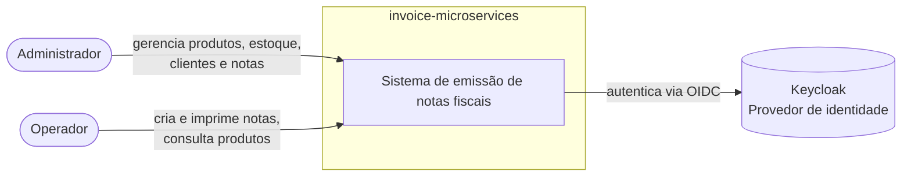
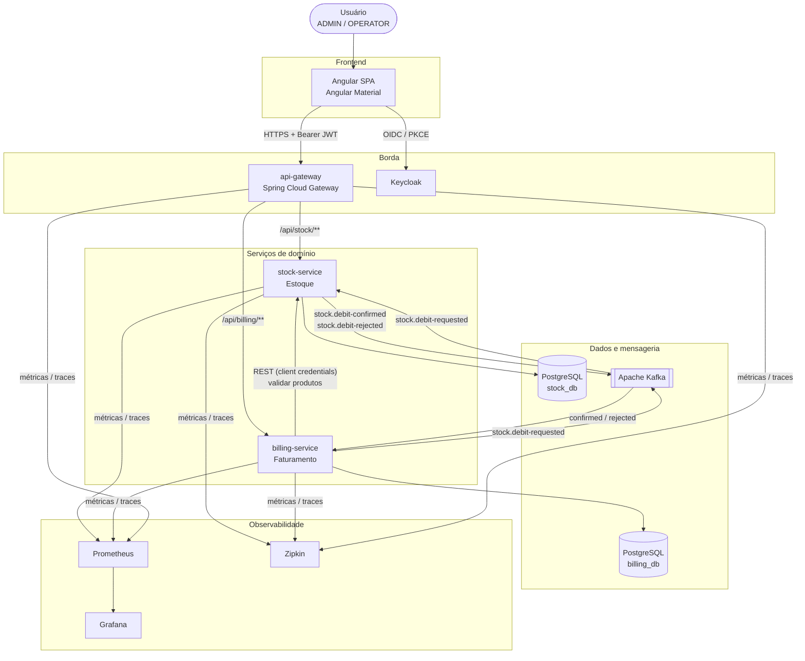
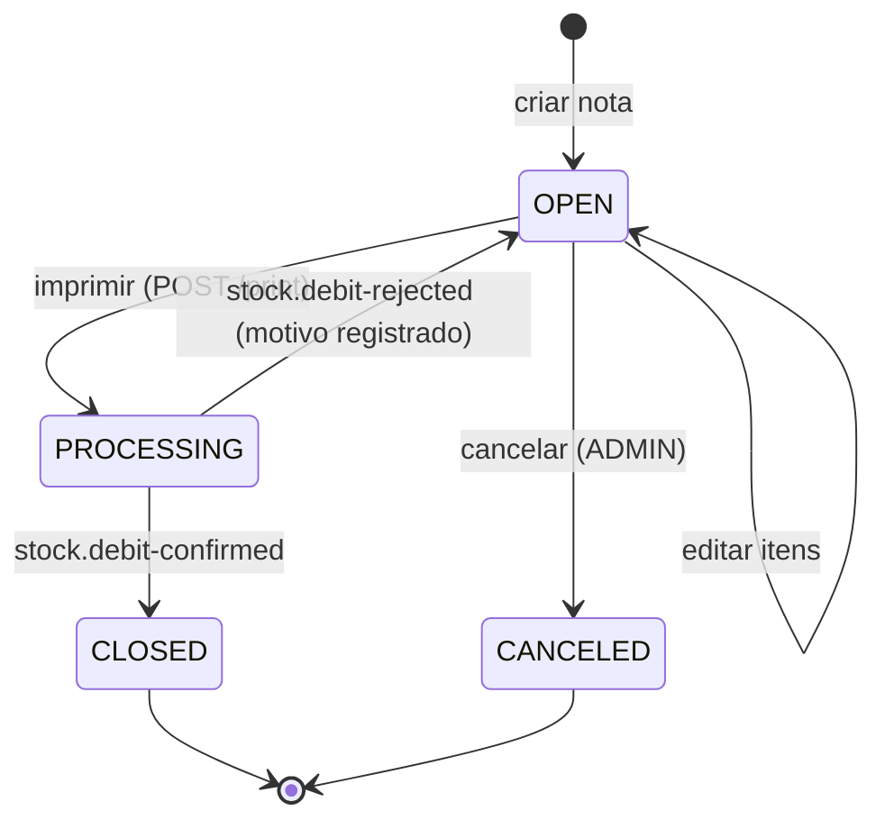
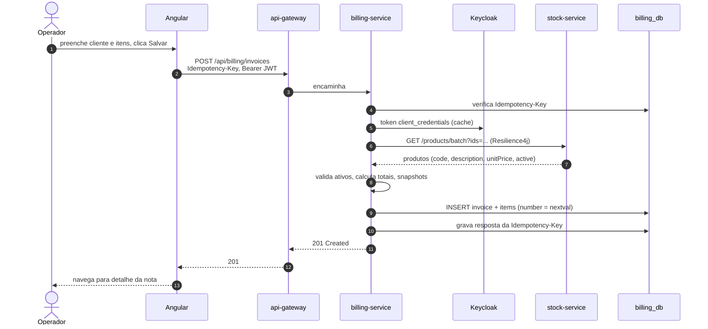
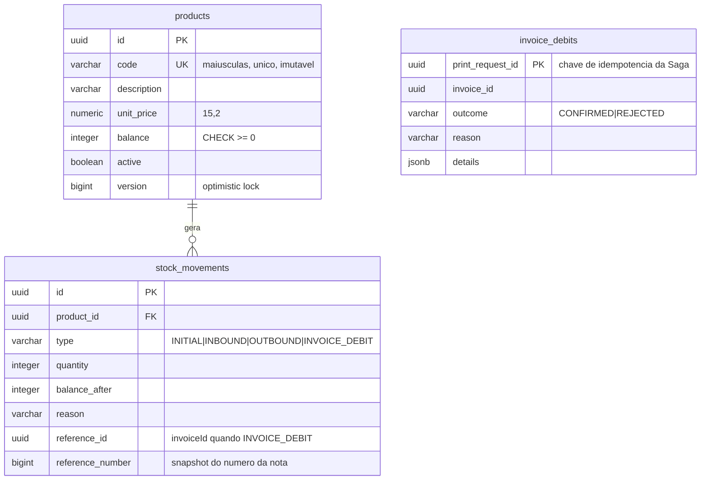
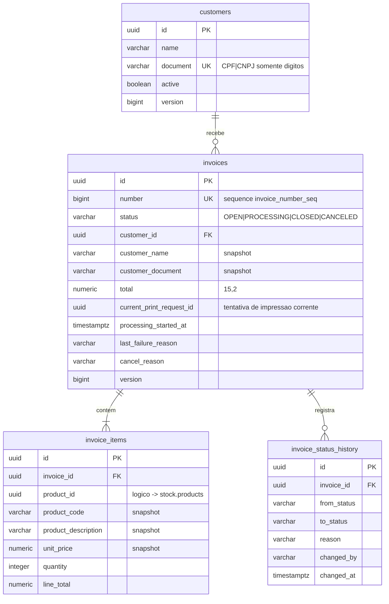
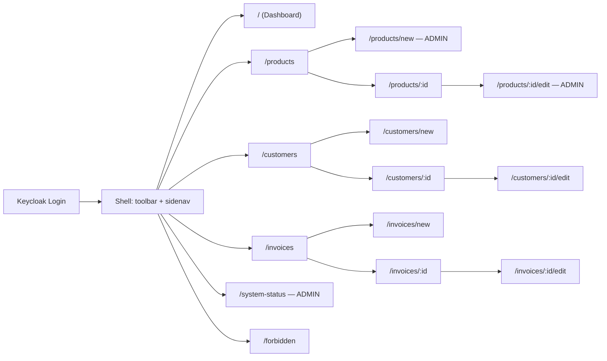

# invoice-microservices — Documento de Requisitos

| Campo | Valor |
|---|---|
| Projeto | `invoice-microservices` — Sistema de emissão de notas fiscais em microsserviços |
| Versão do documento | 1.0 |
| Data | 2026-09-12 |
| Status | Aprovado para desenvolvimento |
| Stack | Java 21 · Spring Boot 4 · Spring Cloud Gateway · Apache Kafka · PostgreSQL · Keycloak · Angular 20+ · Angular Material · Docker Compose |

---

## Sumário

1. [Introdução](#1-introdução)
2. [Visão geral do produto](#2-visão-geral-do-produto)
3. [Requisitos funcionais](#3-requisitos-funcionais)
4. [Regras de negócio](#4-regras-de-negócio)
5. [Máquina de estados da nota fiscal](#5-máquina-de-estados-da-nota-fiscal)
6. [Fluxos principais](#6-fluxos-principais)
7. [Requisitos não funcionais](#7-requisitos-não-funcionais)
8. [Arquitetura e decisões técnicas](#8-arquitetura-e-decisões-técnicas)
9. [Interface do usuário](#9-interface-do-usuário)
10. [Estratégia de testes](#10-estratégia-de-testes)
11. [Plano de entrega](#11-plano-de-entrega)
12. [Definition of Done](#12-definition-of-done)
13. [Riscos e mitigações](#13-riscos-e-mitigações)
14. [ADRs previstos](#14-adrs-previstos)

---

## 1. Introdução

### 1.1 Propósito

Este documento especifica os requisitos funcionais, não funcionais, regras de negócio e decisões arquiteturais do sistema **invoice-microservices**. Ele é a fonte de verdade para o desenvolvimento e serve de referência para quem avaliar o projeto (recrutadores, revisores técnicos) entenderem *o que* foi construído e *por que* cada decisão foi tomada.

### 1.2 Escopo do produto

Sistema web para cadastro de produtos com controle de estoque, cadastro de clientes e emissão de notas fiscais. A "emissão" (impressão) de uma nota fecha a nota, baixa o estoque dos produtos envolvidos e disponibiliza um PDF. O sistema é composto por dois microsserviços de domínio (Estoque e Faturamento), um API Gateway, um provedor de identidade e um frontend Angular, todos executáveis localmente com um único comando.

O sistema **não** integra com SEFAZ nem gera documentos fiscais eletrônicos reais (NF-e/DANFE). "Nota fiscal" aqui é um documento interno simplificado.

### 1.3 Público-alvo do documento

- Desenvolvedor(a) do projeto (autor).
- Recrutadores e revisores técnicos que avaliarão o repositório.

### 1.4 Convenções

| Prefixo | Significado |
|---|---|
| `RF-XXX-nn` | Requisito funcional, agrupado por módulo (AUTH, PRD, STK, CUS, INV, PRT, RES, DIAG) |
| `RN-nn` | Regra de negócio |
| `RNF-XXX-nn` | Requisito não funcional, agrupado por categoria |
| Prioridade | MoSCoW: **Must** (obrigatório), **Should** (importante), **Could** (desejável) |
| Fase | F1 (MVP), F2 (Robustez), F3 (Qualidade e entrega) — ver [§11](#11-plano-de-entrega) |

Idioma: documentação em português (pt-BR); código, identificadores, nomes de domínio, commits e mensagens de log em inglês.

### 1.5 Glossário

| Termo | Definição |
|---|---|
| Produto (Product) | Item cadastrado no Estoque, identificado por código único, com descrição, preço unitário e saldo. |
| Saldo (balance) | Quantidade disponível em estoque de um produto. Nunca negativo. |
| Movimentação (StockMovement) | Registro imutável de entrada ou saída de estoque, com saldo resultante. |
| Cliente (Customer) | Destinatário de uma nota fiscal, cadastrado no Faturamento. |
| Nota fiscal (Invoice) | Documento com numeração sequencial, cliente, itens (produto + quantidade + preço) e status. |
| Impressão / Fechamento | Ação que inicia a Saga de baixa de estoque e, se bem-sucedida, leva a nota ao status `CLOSED` e disponibiliza o PDF. |
| Saga | Transação distribuída coordenada por eventos entre Faturamento e Estoque. |
| Outbox | Tabela transacional onde eventos são gravados junto com a mudança de estado, para publicação posterior no Kafka. |
| Idempotência | Propriedade pela qual repetir uma operação não produz efeito adicional. |
| Circuit breaker | Mecanismo que interrompe chamadas a um serviço que está falhando, permitindo recuperação. |
| ProblemDetail | Formato padronizado de erro HTTP (RFC 9457). |
| ADR | Architecture Decision Record — registro de uma decisão arquitetural e sua justificativa. |

---

## 2. Visão geral do produto

### 2.1 Objetivos

| # | Objetivo | Como será evidenciado |
|---|---|---|
| O1 | Demonstrar Angular moderno (standalone, signals, control flow, RxJS aplicado com critério) | Frontend completo com telas de CRUD, fluxo assíncrono com polling, guards e interceptors |
| O2 | Demonstrar Java/Spring em nível profissional | Arquitetura hexagonal, testes em múltiplos níveis, tratamento de erros padronizado, código sem "mágica" |
| O3 | Demonstrar arquitetura de microsserviços real | Banco por serviço, comunicação síncrona + assíncrona, Saga com Outbox, idempotência, resiliência, observabilidade |
| O4 | Demonstrar maturidade de engenharia | Docker Compose one-command, CI/CD, ADRs, diagramas C4, OpenAPI/AsyncAPI, releases versionadas |

### 2.2 Diagrama de contexto (C4 — nível 1)



### 2.3 Diagrama de containers (C4 — nível 2)



### 2.4 Perfis de usuário

| Perfil (role) | Descrição | Permissões |
|---|---|---|
| `ADMIN` | Gestor do sistema | Tudo: CRUD de produtos, movimentações de estoque, inativar clientes, cancelar notas, painel de diagnóstico e controle de chaos |
| `OPERATOR` | Operador de faturamento | Consultar produtos; criar/editar clientes; criar, editar e imprimir notas; baixar PDF |
| `SERVICE` | Conta de serviço (máquina-a-máquina) | Endpoints internos do Estoque consumidos pelo Faturamento |

### 2.5 Premissas

- P1. O sistema roda localmente via Docker Compose; não haverá deploy público.
- P2. Um único tenant/empresa; não há multi-tenancy.
- P3. Quantidades são inteiras (unidades); preços são decimais com 2 casas.
- P4. Consistência eventual entre Faturamento e Estoque é aceitável e desejada (é o que se pretende demonstrar).
- P5. As versões exatas de Java, Spring Boot e Angular serão fixadas no bootstrap do projeto (última estável/LTS disponível compatível com as escolhas deste documento) e registradas em ADR.

### 2.6 Restrições

- C1. Backend em Java 21+ com Spring Boot 4.x; frontend em Angular 20+.
- C2. Sem Lombok; DTOs como `record`; mapeamento com MapStruct.
- C3. Um banco PostgreSQL por serviço; nenhum serviço acessa o banco do outro.
- C4. Comunicação síncrona apenas para consultas; toda mudança de estado entre serviços é via eventos Kafka.
- C5. Código e commits em inglês; documentação em português.

### 2.7 Fora de escopo

- Integração com SEFAZ, NF-e, DANFE, impostos, CFOP, NCM.
- Funcionalidades de IA.
- Deploy em nuvem/Kubernetes (Compose apenas).
- Multi-tenancy, multi-empresa, multi-moeda.
- Relatórios gerenciais além das listagens.
- Notificações por e-mail.
- HTTPS no ambiente local (documentado como responsabilidade de um reverse proxy em produção).

---

## 3. Requisitos funcionais

Cada requisito traz prioridade (MoSCoW), fase de entrega e critérios de aceite verificáveis.

### 3.1 Autenticação e autorização (RF-AUTH)

| ID | Título | Prioridade | Fase |
|---|---|---|---|
| RF-AUTH-01 | Login via Keycloak (OIDC + PKCE) | Must | F2 |
| RF-AUTH-02 | Autorização por perfil no backend | Must | F2 |
| RF-AUTH-03 | Autorização por perfil no frontend | Must | F2 |
| RF-AUTH-04 | Logout | Must | F2 |
| RF-AUTH-05 | Autenticação serviço-a-serviço | Must | F2 |

**RF-AUTH-01 — Login via Keycloak.** O usuário não autenticado que acessa qualquer rota protegida é redirecionado ao Keycloak. Após login, retorna à rota original com token válido.
- CA1: Acesso a `/products` sem sessão → redireciona para o Keycloak; após login → volta para `/products`.
- CA2: Token expirado é renovado silenciosamente (refresh) sem intervenção do usuário.
- CA3: Usuários seed `admin` e `operator` existem no realm importado.

**RF-AUTH-02 — Autorização no backend.** Todo endpoint (exceto `/actuator/health` e documentação OpenAPI) exige JWT válido; endpoints restritos verificam role via `@PreAuthorize`.
- CA1: Requisição sem token → `401` (ProblemDetail).
- CA2: `OPERATOR` chamando `POST /api/stock/products` → `403`.
- CA3: Token assinado por outro emissor ou expirado → `401`.

**RF-AUTH-03 — Autorização no frontend.** Guards de rota e diretiva estrutural escondem rotas/ações não permitidas ao perfil.
- CA1: `OPERATOR` não vê o botão "Novo produto" nem a rota `/products/new` (redireciona para `/forbidden`).
- CA2: Menu lateral exibe apenas itens permitidos ao perfil logado.

**RF-AUTH-04 — Logout.** Botão de logout encerra a sessão no Keycloak e limpa o estado local.

**RF-AUTH-05 — Autenticação serviço-a-serviço.** `billing-service` obtém token via *client credentials* (client `billing-service` no Keycloak) para chamar endpoints internos do `stock-service`, que exigem role `SERVICE`.
- CA1: Chamada de `billing-service` a `GET /api/stock/products/batch` sem token de serviço → `401`.
- CA2: Token de serviço é cacheado e renovado antes de expirar.

### 3.2 Produtos (RF-PRD)

| ID | Título | Prioridade | Fase |
|---|---|---|---|
| RF-PRD-01 | Cadastrar produto | Must | F1 |
| RF-PRD-02 | Listar produtos com busca, filtro e paginação | Must | F1 |
| RF-PRD-03 | Consultar produto | Must | F1 |
| RF-PRD-04 | Editar produto | Must | F1 |
| RF-PRD-05 | Inativar e reativar produto | Must | F1 |
| RF-PRD-06 | Consulta em lote (interna) | Must | F1 |

**RF-PRD-01 — Cadastrar produto.** Campos: `code` (obrigatório, único), `description` (obrigatório), `unitPrice` (obrigatório, ≥ 0), `initialBalance` (obrigatório, ≥ 0). O saldo inicial gera uma movimentação `INITIAL`.
- CA1: `POST /api/stock/products` com dados válidos → `201 Created`, header `Location`, corpo com o produto e `balance = initialBalance`.
- CA2: Código já existente (comparação case-insensitive, sem espaços nas pontas) → `409` com `type = product-code-already-exists`.
- CA3: Campos inválidos (código vazio, preço negativo, saldo negativo) → `400` com lista de campos inválidos.
- CA4: Requisição exige header `Idempotency-Key` (ver RN-16).
- CA5: Na UI, formulário reativo tipado com validação síncrona e mensagens de erro por campo; código é convertido para maiúsculas.

**RF-PRD-02 — Listar produtos.** Listagem paginada e ordenável com busca textual por código/descrição e filtro por ativo/inativo.
- CA1: `GET /api/stock/products?search=par&active=true&page=0&size=20&sort=code,asc` retorna página com `content`, `totalElements`, `totalPages`, `number`, `size`.
- CA2: Busca é case-insensitive e parcial (`ILIKE %termo%`).
- CA3: Na UI, tabela Material com paginação server-side, ordenação e campo de busca com `debounceTime(300)` + `distinctUntilChanged` + `switchMap`.
- CA4: Produtos com saldo zero são destacados visualmente.

**RF-PRD-03 — Consultar produto.** Detalhe com dados cadastrais, saldo atual e histórico de movimentações (RF-STK-02).
- CA1: `GET /api/stock/products/{id}` → `200`; id inexistente → `404` (`product-not-found`).

**RF-PRD-04 — Editar produto.** Permite alterar `description` e `unitPrice`. `code` é imutável; `balance` só muda por movimentação.
- CA1: `PUT /api/stock/products/{id}` com `code` diferente do atual → `400` (`field-immutable`).
- CA2: Edição concorrente (versão desatualizada) → `409` (`optimistic-lock-conflict`) e a UI oferece recarregar.

**RF-PRD-05 — Inativar e reativar produto.** Exclusão é lógica (`active = false`).
- CA1: `DELETE /api/stock/products/{id}` → `204`; produto some das listagens padrão (`active=true`) mas continua acessível por id.
- CA2: `POST /api/stock/products/{id}/reactivate` → `200`.
- CA3: Produto inativo não pode ser adicionado a novas notas (RN-03).

**RF-PRD-06 — Consulta em lote (interna).** Usada pelo `billing-service` para validar itens de nota.
- CA1: `GET /api/stock/products/batch?ids=a,b,c` → `200` com lista de `{id, code, description, unitPrice, balance, active}`; ids inexistentes são omitidos.
- CA2: Exige role `SERVICE`, `OPERATOR` ou `ADMIN`.

### 3.3 Movimentação de estoque (RF-STK)

| ID | Título | Prioridade | Fase |
|---|---|---|---|
| RF-STK-01 | Registrar entrada/saída manual | Must | F1 |
| RF-STK-02 | Consultar histórico de movimentações | Must | F1 |
| RF-STK-03 | Baixa automática por nota fiscal | Must | F1 |

**RF-STK-01 — Registrar entrada/saída manual.** `ADMIN` registra `INBOUND` (entrada) ou `OUTBOUND` (saída) com `quantity > 0` e `reason` obrigatório.
- CA1: `POST /api/stock/products/{id}/movements` `{type: "INBOUND", quantity: 5, reason: "Compra NF 123"}` → `201` e saldo atualizado.
- CA2: `OUTBOUND` maior que o saldo → `422` (`insufficient-stock`).
- CA3: Exige `Idempotency-Key`.
- CA4: Na UI, diálogo (MatDialog) a partir da tela de detalhe do produto.

**RF-STK-02 — Consultar histórico.** Lista paginada, ordenada por data desc, com tipo, quantidade, saldo resultante, motivo, referência (id/número da nota quando aplicável) e usuário.
- CA1: `GET /api/stock/products/{id}/movements?page=0&size=20` → `200`.

**RF-STK-03 — Baixa automática por nota.** Ao consumir `stock.debit-requested`, o Estoque baixa todos os itens da nota atomicamente e responde com `stock.debit-confirmed` ou `stock.debit-rejected`. Detalhado em [§6.2–6.6](#6-fluxos-principais).
- CA1: Nota com itens `{A:2, B:3}` e saldos `{A:10, B:5}` → saldos finais `{A:8, B:2}`, duas movimentações `INVOICE_DEBIT` com `referenceId = invoiceId`, evento `confirmed`.
- CA2: Saldos `{A:10, B:1}` → nenhum saldo alterado, evento `rejected` com `details = [{productId: B, requested: 3, available: 1}]`.
- CA3: Evento duplicado (mesmo `eventId`) → ignorado sem nova baixa.
- CA4: Produto inativo ou inexistente → `rejected` com `reason = PRODUCT_INACTIVE | PRODUCT_NOT_FOUND`.

### 3.4 Clientes (RF-CUS)

| ID | Título | Prioridade | Fase |
|---|---|---|---|
| RF-CUS-01 | Cadastrar cliente | Must | F1 |
| RF-CUS-02 | Listar clientes com busca e paginação | Must | F1 |
| RF-CUS-03 | Consultar cliente | Must | F1 |
| RF-CUS-04 | Editar cliente | Must | F1 |
| RF-CUS-05 | Inativar e reativar cliente | Should | F1 |

**RF-CUS-01 — Cadastrar cliente.** Campos: `name` (obrigatório), `document` (obrigatório, CPF ou CNPJ válido — dígitos verificadores — e único), `email` (opcional, formato válido), `phone` (opcional).
- CA1: `POST /api/billing/customers` válido → `201` + `Location`.
- CA2: CPF/CNPJ com dígito verificador inválido → `400` (`validation-error`, campo `document`).
- CA3: Documento já cadastrado → `409` (`customer-document-already-exists`).
- CA4: Na UI, máscara dinâmica CPF/CNPJ e validador customizado síncrono.

**RF-CUS-02 — Listar clientes.** Paginação, busca por nome/documento, filtro ativo/inativo — mesmos padrões de RF-PRD-02.

**RF-CUS-03 — Consultar cliente.** Detalhe com dados cadastrais e lista das últimas notas do cliente.

**RF-CUS-04 — Editar cliente.** Todos os campos exceto `document` (imutável). Controle de versão otimista.

**RF-CUS-05 — Inativar/reativar cliente.** `ADMIN`. Cliente inativo não pode receber novas notas (RN-20).

### 3.5 Notas fiscais (RF-INV)

| ID | Título | Prioridade | Fase |
|---|---|---|---|
| RF-INV-01 | Criar nota fiscal | Must | F1 |
| RF-INV-02 | Listar notas com filtro por status | Must | F1 |
| RF-INV-03 | Consultar nota | Must | F1 |
| RF-INV-04 | Editar itens de nota aberta | Must | F1 |
| RF-INV-05 | Cancelar nota aberta | Must | F1 |
| RF-INV-06 | Histórico de transições de status | Should | F2 |

**RF-INV-01 — Criar nota fiscal.** Entrada: `customerId` e lista de itens `{productId, quantity}` (≥ 1 item, `quantity ≥ 1`). O serviço valida o cliente localmente e os produtos via `stock-service` (RF-PRD-06), grava snapshot de código, descrição e preço unitário em cada item, calcula totais e atribui número sequencial. Status inicial `OPEN`.
- CA1: `POST /api/billing/invoices` válido → `201` com `number`, `status = OPEN`, itens com `productCode`, `productDescription`, `unitPrice`, `lineTotal` e `total` da nota.
- CA2: Produto inexistente ou inativo → `422` (`product-not-found` / `product-inactive`) indicando qual item.
- CA3: Cliente inexistente/inativo → `422`.
- CA4: Produto repetido na lista → `400` (`duplicate-invoice-item`).
- CA5: `stock-service` indisponível → `503` (`stock-service-unavailable`) com mensagem orientando nova tentativa; nada é persistido.
- CA6: Exige `Idempotency-Key`; reenvio idêntico retorna a mesma nota (mesmo `number`), sem criar duplicata.
- CA7: Saldo **não** é verificado nem reservado na criação (RN-09); a UI apenas exibe alerta informativo quando `quantity > balance` atual.
- CA8: Na UI: seleção de cliente por autocomplete; itens adicionados por autocomplete de produto (busca no Estoque com debounce) com exibição de saldo e preço atuais; `FormArray` tipado; totais recalculados via `computed()`.

**RF-INV-02 — Listar notas.** Paginação, ordenação (padrão: `number desc`), filtro por `status`, por cliente e por intervalo de datas.
- CA1: `GET /api/billing/invoices?status=OPEN&page=0&size=20` → `200`.
- CA2: Na UI, chips de status coloridos (`OPEN` azul, `PROCESSING` âmbar com spinner, `CLOSED` verde, `CANCELED` cinza).

**RF-INV-03 — Consultar nota.** Detalhe completo: número, status, cliente (snapshot), itens, totais, datas (`createdAt`, `closedAt`, `canceledAt`), `lastFailureReason` (quando houver) e ações disponíveis conforme status e perfil.

**RF-INV-04 — Editar itens de nota aberta.** Substitui a lista completa de itens (`PUT /api/billing/invoices/{id}/items`). Revalida produtos no Estoque e atualiza snapshots/totais.
- CA1: Nota `OPEN` → `200` com itens atualizados.
- CA2: Nota em qualquer outro status → `409` (`invalid-invoice-status`).
- CA3: Cliente **não** é editável após criação (Could: permitir troca enquanto `OPEN` — F3).

**RF-INV-05 — Cancelar nota aberta.** `ADMIN` cancela nota `OPEN` informando motivo. Sem efeito no estoque (RN-12).
- CA1: `POST /api/billing/invoices/{id}/cancel` `{reason}` → `200`, `status = CANCELED`, `canceledAt` preenchido.
- CA2: Status ≠ `OPEN` → `409`.
- CA3: Na UI, diálogo de confirmação com campo de motivo obrigatório.

**RF-INV-06 — Histórico de transições.** Cada mudança de status é registrada (`from`, `to`, `at`, `by`, `reason`) e exibida em linha do tempo na tela de detalhe.
- CA1: `GET /api/billing/invoices/{id}/history` → lista ordenada.

### 3.6 Impressão / fechamento (RF-PRT)

| ID | Título | Prioridade | Fase |
|---|---|---|---|
| RF-PRT-01 | Imprimir nota (iniciar fechamento) | Must | F1 |
| RF-PRT-02 | Indicador de processamento e acompanhamento de status | Must | F1 |
| RF-PRT-03 | Conclusão: nota fechada e saldo baixado | Must | F1 |
| RF-PRT-04 | Rejeição: nota volta a aberta com motivo | Must | F1 |
| RF-PRT-05 | Geração e download de PDF | Must | F2 |
| RF-PRT-06 | Reconciliação de notas presas em processamento | Could | F3 |

**RF-PRT-01 — Imprimir nota.** Botão "Imprimir" visível e destacado na tela de detalhe e na listagem (para notas `OPEN`). Dispara `POST /api/billing/invoices/{id}/print`, que muda o status para `PROCESSING` e grava o evento `stock.debit-requested` na Outbox, na mesma transação.
- CA1: Nota `OPEN` → `202 Accepted`, corpo `{id, status: "PROCESSING"}`, header `Location: /api/billing/invoices/{id}`.
- CA2: Nota `PROCESSING`, `CLOSED` ou `CANCELED` → `409` (`invalid-invoice-status`) sem efeito colateral.
- CA3: Exige `Idempotency-Key`; reenvio idêntico retorna `202` com o mesmo corpo sem publicar novo evento.
- CA4: Botão desabilitado para notas fora de `OPEN`.

**RF-PRT-02 — Indicador de processamento.** Após o `202`, a UI exibe indicador de processamento (barra/spinner + chip `PROCESSING`) e faz polling em `GET /api/billing/invoices/{id}` a cada 1,5 s até o status sair de `PROCESSING`, com limite de 30 s.
- CA1: Polling implementado com `timer(0, 1500).pipe(switchMap(...), takeWhile(status === 'PROCESSING', true), timeout(30000), takeUntilDestroyed())`.
- CA2: Ao concluir (`CLOSED`), snackbar de sucesso e botão "Baixar PDF" fica disponível.
- CA3: Ao atingir 30 s ainda em `PROCESSING`: mensagem "A nota continua em processamento. O serviço de estoque pode estar indisponível; a operação será concluída automaticamente quando ele se recuperar." Polling encerra; usuário pode recarregar manualmente.
- CA4: Navegar para fora da tela cancela o polling (sem vazamento de subscription).

**RF-PRT-03 — Conclusão.** Ao consumir `stock.debit-confirmed`, o Faturamento muda o status para `CLOSED`, registra `closedAt` e o histórico.
- CA1: Estado final consistente: nota `CLOSED` **e** saldos baixados **e** movimentações `INVOICE_DEBIT` registradas.
- CA2: Consumo duplicado do evento não altera nada (idempotente).

**RF-PRT-04 — Rejeição.** Ao consumir `stock.debit-rejected`, o Faturamento retorna a nota para `OPEN`, preenche `lastFailureReason` (texto legível, ex.: "Saldo insuficiente para PARAFUSO-M6 (solicitado 3, disponível 1)") e registra o histórico.
- CA1: UI exibe o motivo em destaque (banner de alerta) na tela de detalhe e permite editar itens e tentar novamente.
- CA2: Nova tentativa bem-sucedida limpa `lastFailureReason`.

**RF-PRT-05 — PDF.** `GET /api/billing/invoices/{id}/pdf` gera (sob demanda) um PDF A4 com cabeçalho (número, data de emissão, status), dados do cliente, tabela de itens (código, descrição, quantidade, preço unitário, total do item) e total geral.
- CA1: Nota `CLOSED` → `200`, `Content-Type: application/pdf`, `Content-Disposition: inline; filename="invoice-000123.pdf"`.
- CA2: Status ≠ `CLOSED` → `409` (`invalid-invoice-status`).
- CA3: Na UI, botão "Baixar PDF" abre em nova aba; visível apenas para `CLOSED`.
- CA4: Valores formatados em pt-BR (`R$ 1.234,56`).

**RF-PRT-06 — Reconciliação.** Job agendado no Faturamento identifica notas em `PROCESSING` há mais de N minutos (configurável, padrão 10) e republica o evento `stock.debit-requested` (idempotente no consumidor) — cobre perda do evento após publicação.

### 3.7 Resiliência e feedback ao usuário (RF-RES)

| ID | Título | Prioridade | Fase |
|---|---|---|---|
| RF-RES-01 | Feedback padronizado de erros na UI | Must | F1 |
| RF-RES-02 | Recuperação após indisponibilidade do Estoque (fluxo assíncrono) | Must | F1 |
| RF-RES-03 | Circuit breaker nas chamadas síncronas ao Estoque | Must | F1 |
| RF-RES-04 | Página de status do sistema | Should | F2 |

**RF-RES-01 — Feedback de erros.** Interceptor HTTP global converte `ProblemDetail` em mensagens ao usuário: `400/422` → erros no formulário/campo; `401` → redireciona ao login; `403` → página "Sem permissão"; `404` → página/snackbar "Não encontrado"; `409` → snackbar com ação "Recarregar"; `503` → snackbar persistente com ação "Tentar novamente"; erro de rede → banner "Sem conexão com o servidor".
- CA1: Toda mensagem exibida ao usuário é legível (sem stack trace ou JSON bruto).
- CA2: Cada erro exibido inclui o `traceId` (discreto, copiável) para correlação com logs/Zipkin.

**RF-RES-02 — Recuperação (assíncrono).** Cenário obrigatório de falha: com o `stock-service` parado (`docker compose stop stock-service`), o usuário imprime uma nota.
- CA1: A nota fica `PROCESSING`; a UI informa após o timeout (RF-PRT-02 CA3).
- CA2: O evento permanece no Kafka; ao religar o serviço (`docker compose start stock-service`), ele consome, baixa o estoque e a nota é fechada **sem intervenção do usuário**.
- CA3: Ao recarregar a tela, o usuário vê `CLOSED` e o saldo atualizado.

**RF-RES-03 — Circuit breaker (síncrono).** Cenário de falha na criação/edição de nota com o Estoque indisponível ou lento.
- CA1: Timeout de 2 s por chamada; retry 2× com backoff exponencial apenas para erros de rede/5xx.
- CA2: Após 50 % de falhas em janela de 10 chamadas, o circuito abre por 10 s; chamadas subsequentes falham imediatamente com `503` sem esperar timeout.
- CA3: Em meio-aberto, chamadas de teste reabrem ou fecham o circuito; a recuperação é automática.
- CA4: Estado do circuito exposto em `/actuator/health` e em métrica Prometheus.

**RF-RES-04 — Página de status.** Tela "Status do sistema" exibe saúde de cada serviço (gateway, stock, billing, Kafka, bancos) consultando `/actuator/health` via gateway, com atualização automática a cada 5 s, e o estado dos circuit breakers.

### 3.8 Diagnóstico e chaos (RF-DIAG)

| ID | Título | Prioridade | Fase |
|---|---|---|---|
| RF-DIAG-01 | Endpoint de injeção de falhas no Estoque | Should | F2 |
| RF-DIAG-02 | Painel de chaos na UI | Should | F2 |

**RF-DIAG-01 — Chaos endpoint.** `stock-service` expõe `GET/PUT /api/stock/admin/chaos` (`ADMIN`) com `{mode: OFF | LATENCY | ERROR, latencyMs, failureRate}`. Em `LATENCY`, endpoints REST atrasam `latencyMs`; em `ERROR`, respondem `500` em `failureRate` % das chamadas. Não afeta consumidores Kafka nem `/actuator`.
- CA1: Configuração em memória, reiniciada com o serviço; desabilitada por padrão via propriedade `app.chaos.enabled=false` fora do perfil `demo`.

**RF-DIAG-02 — Painel de chaos.** Na página de status, `ADMIN` alterna o modo de chaos e observa em tempo real o circuit breaker abrir/fechar.

---

## 4. Regras de negócio

| ID | Regra | Onde se aplica |
|---|---|---|
| RN-01 | O código do produto é único (case-insensitive, sem espaços nas pontas), armazenado em maiúsculas e imutável após a criação. | Estoque |
| RN-02 | O saldo de um produto nunca é negativo. Qualquer operação que resultaria em saldo negativo é rejeitada. | Estoque |
| RN-03 | Produto inativo não pode ser incluído em novas notas nem ter saldo baixado; permanece visível em notas já existentes (snapshot). | Estoque, Faturamento |
| RN-04 | Produto nunca é excluído fisicamente; apenas inativado. | Estoque |
| RN-05 | Toda alteração de saldo gera uma movimentação imutável (`INITIAL`, `INBOUND`, `OUTBOUND`, `INVOICE_DEBIT`) com o saldo resultante. | Estoque |
| RN-06 | A numeração da nota é sequencial, gerada por `sequence` do banco e atribuída na criação; é imutável. Lacunas por transações revertidas são toleradas. | Faturamento |
| RN-07 | Nota é criada com status `OPEN`, com pelo menos um item; cada item tem `quantity ≥ 1` (inteiro). | Faturamento |
| RN-08 | Um produto não pode aparecer mais de uma vez na mesma nota. | Faturamento |
| RN-09 | Saldo não é verificado nem reservado na criação/edição da nota; a verificação ocorre exclusivamente no fechamento. | Faturamento, Estoque |
| RN-10 | Apenas notas `OPEN` podem ser editadas, canceladas ou impressas. | Faturamento |
| RN-11 | Impressão leva a nota a `PROCESSING`; confirmação do Estoque leva a `CLOSED`; rejeição ou falha leva de volta a `OPEN` com motivo registrado. | Faturamento |
| RN-12 | A baixa de estoque de uma nota é atômica: todos os itens são baixados ou nenhum. | Estoque |
| RN-13 | Saldo insuficiente em qualquer item rejeita a nota inteira, detalhando cada item insuficiente (solicitado × disponível). | Estoque |
| RN-14 | Cancelamento não afeta o estoque (nunca houve baixa). | Faturamento |
| RN-15 | `CLOSED` e `CANCELED` são estados terminais. | Faturamento |
| RN-16 | Requisições `POST` de criação/ação exigem header `Idempotency-Key` (UUID). Mesma chave + mesmo payload → mesma resposta; mesma chave + payload diferente → `422`; chave em processamento → `409`. Chaves expiram em 24 h. | Todos os serviços |
| RN-17 | A baixa de estoque para uma nota é processada no máximo uma vez: eventos são deduplicados por `eventId` e solicitações por `printRequestId`; uma nota só pode ter uma baixa confirmada. | Estoque |
| RN-18 | O item da nota guarda snapshot de código, descrição e preço unitário do produto no momento da inclusão; alterações posteriores no produto não afetam notas existentes. | Faturamento |
| RN-19 | Total do item = `quantity × unitPrice`; total da nota = soma dos itens. Escala 2, arredondamento `HALF_UP`. | Faturamento |
| RN-20 | O documento do cliente (CPF/CNPJ) é único, validado por dígitos verificadores e imutável. Cliente inativo não pode receber novas notas. | Faturamento |
| RN-21 | A nota guarda snapshot de nome e documento do cliente. | Faturamento |
| RN-22 | `OPERATOR` pode criar, editar e imprimir notas e criar/editar clientes; somente `ADMIN` cancela notas, gerencia produtos, movimenta estoque, inativa clientes e controla chaos. | Todos |
| RN-23 | PDF só é disponibilizado para notas `CLOSED`. | Faturamento |

---

## 5. Máquina de estados da nota fiscal



| De | Para | Gatilho | Pré-condições | Efeitos |
|---|---|---|---|---|
| — | `OPEN` | `POST /invoices` | Cliente ativo; produtos existentes e ativos | Número atribuído; snapshots gravados |
| `OPEN` | `OPEN` | `PUT /invoices/{id}/items` | — | Itens/snapshots/totais atualizados |
| `OPEN` | `PROCESSING` | `POST /invoices/{id}/print` | — | Outbox: `stock.debit-requested`; `lastFailureReason` mantido até resultado |
| `OPEN` | `CANCELED` | `POST /invoices/{id}/cancel` | Perfil `ADMIN` | `canceledAt`, motivo |
| `PROCESSING` | `CLOSED` | Evento `stock.debit-confirmed` | Evento não processado antes | `closedAt`; `lastFailureReason = null` |
| `PROCESSING` | `OPEN` | Evento `stock.debit-rejected` | Evento não processado antes | `lastFailureReason` preenchido |

Transições inválidas retornam `409 invalid-invoice-status` com `currentStatus` e `allowedTransitions` no corpo.

---

## 6. Fluxos principais

### 6.1 Criação de nota



### 6.2 Fechamento (Saga) — caminho feliz

```mermaid
sequenceDiagram
    autonumber
    actor U as Operador
    participant FE as Angular
    participant B as billing-service
    participant OB as outbox (billing_db)
    participant K as Kafka
    participant S as stock-service
    participant SDB as stock_db

    U->>FE: clica Imprimir
    FE->>B: POST /invoices/{id}/print (Idempotency-Key)
    B->>B: OPEN → PROCESSING
    B->>OB: INSERT event stock.debit-requested (mesma TX)
    B-->>FE: 202 Accepted
    FE->>FE: inicia polling (1,5 s, máx. 30 s)
    loop poller (500 ms)
        B->>OB: SELECT não publicados
        B->>K: publish stock.debit-requested (key = invoiceId)
        B->>OB: UPDATE published_at
    end
    K->>S: consume
    S->>SDB: processed_events? (dedupe)
    S->>SDB: TX: para cada item: load, check active/balance,<br/>balance -= qty (@Version), INSERT movement
    S->>SDB: INSERT outbox stock.debit-confirmed
    S->>K: publish stock.debit-confirmed
    K->>B: consume
    B->>B: dedupe; PROCESSING → CLOSED
    FE->>B: GET /invoices/{id}
    B-->>FE: status CLOSED
    FE-->>U: snackbar "Nota fechada"; botão Baixar PDF
```

### 6.3 Fechamento — saldo insuficiente

Igual a 6.2 até o passo do Estoque. Ao encontrar item com `balance < quantity`, o Estoque reverte a transação (nenhum saldo alterado), grava `stock.debit-rejected` na Outbox com `reason = INSUFFICIENT_STOCK` e `details[]`. O Faturamento consome, muda `PROCESSING → OPEN`, preenche `lastFailureReason`. A UI, ao receber `OPEN` no polling, exibe banner com o motivo e mantém o botão "Imprimir" habilitado.

### 6.4 Fechamento — stock-service indisponível (recuperação automática)

```mermaid
sequenceDiagram
    autonumber
    actor U as Operador
    participant FE as Angular
    participant B as billing-service
    participant K as Kafka
    participant S as stock-service (parado)

    Note over S: docker compose stop stock-service
    U->>FE: clica Imprimir
    FE->>B: POST /print
    B-->>FE: 202 (PROCESSING)
    B->>K: publish stock.debit-requested
    Note over K: mensagem retida no tópico
    FE->>FE: polling até 30 s
    FE-->>U: "Nota continua em processamento; será concluída quando o Estoque se recuperar"
    Note over S: docker compose start stock-service
    K->>S: consume (offset pendente)
    S->>K: stock.debit-confirmed
    K->>B: consume → CLOSED
    U->>FE: recarrega tela
    FE-->>U: CLOSED, saldo atualizado
```

### 6.5 Criação de nota com stock-service indisponível (circuit breaker)

1. Estoque parado ou em modo chaos `ERROR`/`LATENCY`.
2. `POST /invoices` → `billing-service` chama `GET /products/batch` → timeout (2 s) / 500 → retry 2× → falha.
3. Resposta `503 stock-service-unavailable`; nada persistido; Idempotency-Key não é consumida (pode reenviar).
4. UI: snackbar persistente "Serviço de estoque indisponível. Tente novamente em instantes." com ação "Tentar novamente".
5. Após 5 falhas em 10 chamadas o circuito abre: novas tentativas falham em < 50 ms, sem sobrecarregar o Estoque.
6. Após 10 s, meio-aberto; se o Estoque respondeu, fecha e o fluxo volta ao normal.

### 6.6 Concorrência — duas notas disputando saldo 1

Cenário: produto `P` com `balance = 1`; notas `N1` e `N2`, ambas com item `{P: 1}`, impressas simultaneamente.

1. Ambos os eventos `stock.debit-requested` chegam ao Estoque (possivelmente em partições diferentes, processados em paralelo).
2. Os dois consumidores carregam `P` com `version = 5`, `balance = 1`.
3. Consumidor A grava `balance = 0, version = 6` — sucesso.
4. Consumidor B tenta gravar com `version = 5` → `OptimisticLockException`.
5. Consumidor B faz retry (até 3×, backoff 100 ms → 400 ms): recarrega `P` (`balance = 0`) → saldo insuficiente → `stock.debit-rejected`.
6. Resultado: exatamente uma nota `CLOSED`, a outra `OPEN` com motivo; `balance = 0`; uma única movimentação `INVOICE_DEBIT`.

Teste automatizado reproduz o cenário com dois threads e `CountDownLatch` sobre PostgreSQL real (Testcontainers).

### 6.7 Idempotência

**HTTP.** Cliente reenvia `POST /invoices` (mesma `Idempotency-Key`, mesmo corpo) após timeout de rede: o serviço encontra a chave, compara o hash do corpo e devolve a resposta armazenada (`201` com a mesma nota). Corpo diferente → `422 idempotency-key-payload-mismatch`. Chave ainda em processamento → `409 idempotency-key-in-flight`.

**Mensageria.** Kafka entrega ao menos uma vez. Cada consumidor grava `(eventId, consumerGroup)` em `processed_events` na mesma transação do efeito; evento repetido é reconhecido e descartado. Adicionalmente, cada `POST /print` gera um `printRequestId` que viaja no evento: o Estoque registra o resultado de cada `printRequestId` em `invoice_debits` (chave primária) e, se a mesma solicitação chegar de novo com outro `eventId` — por exemplo, republicada pelo job de reconciliação —, apenas reemite o resultado gravado; um índice único parcial garante no máximo uma baixa `CONFIRMED` por `invoiceId`. O Faturamento, por sua vez, ignora resultados cujo `printRequestId` não seja o corrente da nota.

---

## 7. Requisitos não funcionais

### 7.1 Arquitetura (RNF-ARC)

| ID | Requisito |
|---|---|
| RNF-ARC-01 | Dois microsserviços de domínio independentes (`stock-service`, `billing-service`), cada um com seu próprio banco PostgreSQL, deploy e ciclo de vida. |
| RNF-ARC-02 | Nenhum serviço acessa diretamente o banco de outro; integração apenas via REST (consultas) e Kafka (eventos). |
| RNF-ARC-03 | Cada serviço segue arquitetura hexagonal; o pacote `domain` não depende de Spring, JPA ou Kafka (verificado por ArchUnit). |
| RNF-ARC-04 | Ponto único de entrada via `api-gateway` (roteamento, CORS, validação de JWT, correlação). |
| RNF-ARC-05 | Eventos de integração são gravados via Outbox Pattern na mesma transação da mudança de estado e publicados por poller. |

### 7.2 Desempenho (RNF-PERF)

| ID | Requisito |
|---|---|
| RNF-PERF-01 | Endpoints de CRUD respondem em p95 < 300 ms em ambiente local com dados de seed. |
| RNF-PERF-02 | Fechamento de nota (do `202` ao `CLOSED`) conclui em < 3 s com todos os serviços saudáveis. |
| RNF-PERF-03 | Listagens são paginadas no servidor (tamanho máximo 100) e usam índices para busca/ordenação. |
| RNF-PERF-04 | Poller da Outbox: intervalo 500 ms, lote de 100 eventos. |

### 7.3 Resiliência e consistência (RNF-RES)

| ID | Requisito |
|---|---|
| RNF-RES-01 | Chamadas síncronas Faturamento → Estoque protegidas por Resilience4j: `TimeLimiter` 2 s, `Retry` 2× (backoff exponencial, só para `IOException`/5xx), `CircuitBreaker` (janela 10, limiar 50 %, aberto 10 s, 3 chamadas em meio-aberto). |
| RNF-RES-02 | Consumidores Kafka: `DefaultErrorHandler` com 5 tentativas (backoff 1 s × 2) e envio para Dead Letter Topic `<topic>.DLT`; exceções de negócio (rejeição) **não** vão para DLT — geram evento `rejected`. |
| RNF-RES-03 | Consumidores são idempotentes (tabela `processed_events`); garantia efetiva de processamento único. |
| RNF-RES-04 | `OptimisticLockException` em consumidores é tratada com retry local (3×) antes de propagar. |
| RNF-RES-05 | Serviços iniciam mesmo com Kafka/Keycloak temporariamente indisponíveis e se reconectam automaticamente; healthcheck reflete o estado. |
| RNF-RES-06 | Docker Compose declara `healthcheck` e `depends_on: condition: service_healthy` para ordenação de subida. |

### 7.4 Segurança (RNF-SEC)

| ID | Requisito |
|---|---|
| RNF-SEC-01 | Autenticação OIDC com Keycloak; frontend usa Authorization Code + PKCE (client público); tokens nunca em `localStorage` (memória + refresh via biblioteca). |
| RNF-SEC-02 | Gateway e cada serviço validam JWT (assinatura RS256, `iss`, `exp`, `aud`) como OAuth2 Resource Server — defesa em profundidade. |
| RNF-SEC-03 | Roles do realm (`realm_access.roles`) mapeadas para `ROLE_*`; autorização por método com `@PreAuthorize`. |
| RNF-SEC-04 | Comunicação máquina-a-máquina via client credentials (client confidencial `billing-service`, role `SERVICE`). |
| RNF-SEC-05 | CORS restrito à origem do frontend, configurado apenas no gateway. |
| RNF-SEC-06 | Segredos (client secret, senhas de banco) via variáveis de ambiente; valores de desenvolvimento em `.env.example`; nenhum segredo real versionado. |
| RNF-SEC-07 | Bean Validation em todas as entradas; erros de validação nunca expõem detalhes internos (stack, SQL). |
| RNF-SEC-08 | Endpoints `/actuator/**` expõem apenas `health`, `info`, `prometheus`; demais desabilitados. |

### 7.5 Observabilidade (RNF-OBS)

| ID | Requisito |
|---|---|
| RNF-OBS-01 | Logs estruturados em JSON (Logstash encoder) com `traceId`, `spanId`, `service`, `userId` (quando autenticado) via MDC. |
| RNF-OBS-02 | Tracing distribuído com Micrometer Tracing (Brave) exportado para Zipkin; contexto W3C `traceparent` propagado via HTTP (gateway → serviços) e headers Kafka (produtor → consumidor). Um fechamento de nota aparece como um único trace ponta a ponta. |
| RNF-OBS-03 | Métricas Micrometer expostas em `/actuator/prometheus`: JVM, HTTP server/client, Kafka consumer/producer, HikariCP, Resilience4j, e métricas de negócio: `invoices_created_total`, `invoices_closed_total`, `stock_debit_rejected_total{reason}`, `outbox_pending_events`, `outbox_failed_events`. |
| RNF-OBS-04 | Grafana provisionado com datasource Prometheus e dashboard "invoice-microservices" (latência HTTP, taxa de erro, estado do circuit breaker, lag do consumidor, métricas de negócio). |
| RNF-OBS-05 | `traceId` retornado ao cliente em toda resposta (header `X-Trace-Id`) e incluído no `ProblemDetail`. |

### 7.6 Manutenibilidade e qualidade de código (RNF-MNT)

| ID | Requisito |
|---|---|
| RNF-MNT-01 | Java: Spotless (google-java-format), ArchUnit para regras de dependência hexagonal, JaCoCo com mínimo 80 % de cobertura em `domain` + `application`. |
| RNF-MNT-02 | Angular: ESLint (angular-eslint) + Prettier; `strict: true`; sem `any` explícito; componentes com `ChangeDetectionStrategy.OnPush`. |
| RNF-MNT-03 | Commits seguem Conventional Commits; versionamento semântico com tags `vX.Y.Z`. |
| RNF-MNT-04 | Configuração externalizada (Spring profiles `local`, `docker`, `demo`, `test`; Angular `environment.*`). |
| RNF-MNT-05 | Migrações de banco versionadas com Flyway; `spring.jpa.hibernate.ddl-auto=validate`. |

### 7.7 Portabilidade e execução (RNF-RUN)

| ID | Requisito |
|---|---|
| RNF-RUN-01 | `docker compose up --build` sobe todo o sistema; perfil `observability` adiciona Prometheus/Grafana/Zipkin; perfil `tools` adiciona Kafka UI. |
| RNF-RUN-02 | Pré-requisitos do avaliador: Docker 24+ e Docker Compose v2. Para desenvolvimento: JDK 21, Node 22, Maven 3.9 (ou wrapper). |
| RNF-RUN-03 | Imagens Docker multi-stage; JRE mínimo (`eclipse-temurin:21-jre-alpine` ou distroless); usuário não-root. |
| RNF-RUN-04 | Tempo de subida completa (cold start) < 2 min em máquina de desenvolvimento típica. |

### 7.8 Usabilidade e acessibilidade (RNF-UX)

| ID | Requisito |
|---|---|
| RNF-UX-01 | Interface em português (pt-BR); `LOCALE_ID` pt-BR para datas, números e moeda. |
| RNF-UX-02 | Layout responsivo (desktop-first; usável em 768 px). |
| RNF-UX-03 | Componentes Angular Material com labels, `aria-*` e navegação por teclado; contraste mínimo AA. |
| RNF-UX-04 | Estados de carregamento (skeleton/spinner), vazio ("Nenhum registro") e erro em todas as listagens. |
| RNF-UX-05 | Ações destrutivas ou irreversíveis (cancelar nota, inativar) exigem confirmação. |

### 7.9 Documentação (RNF-DOC)

| ID | Requisito |
|---|---|
| RNF-DOC-01 | `README.md` com visão geral, arquitetura (diagrama), quickstart, credenciais de demo, roteiro de demonstração dos cenários (falha, concorrência, idempotência), GIFs/screenshots e uma seção curta "Como este projeto foi construído" declarando, sem tom de justificativa, que requisitos, arquitetura e decisões são do autor e que a implementação foi feita com agente de código sob processo documentado (`AGENTS.md`, `docs/decisions.md`, `docs/guia-trabalho-com-agente.md`), com revisão humana antes de cada commit. |
| RNF-DOC-02 | ADRs em `docs/adr/` (formato MADR), um por decisão relevante ([§14](#14-adrs-previstos)). |
| RNF-DOC-03 | Diagramas C4 (níveis 1–3) em Mermaid em `docs/architecture/`. |
| RNF-DOC-04 | OpenAPI 3.1 gerado por springdoc em cada serviço, Swagger UI acessível via gateway; arquivo exportado versionado em `docs/api/`. |
| RNF-DOC-05 | AsyncAPI 3.0 descrevendo tópicos, mensagens e schemas em `docs/api/asyncapi.yaml`. |

---

## 8. Arquitetura e decisões técnicas

### 8.1 Stack tecnológica

| Camada | Tecnologia | Justificativa resumida |
|---|---|---|
| Linguagem backend | Java 21 (LTS) | Virtual threads, records, pattern matching; amplamente exigido no mercado |
| Framework | Spring Boot 4.x (Spring Framework 7, Jakarta EE 11), Spring Web MVC, Spring Data JPA, Spring Security, Spring Kafka, Spring Cloud Gateway | Padrão de mercado; ecossistema completo |
| Resiliência | Resilience4j (spring-boot starter) | Circuit breaker, retry, time limiter, métricas prontas |
| Persistência | PostgreSQL 16, Hibernate 7, Flyway | Confiabilidade, sequences, constraints; migrações versionadas |
| Mensageria | Apache Kafka (KRaft, sem ZooKeeper) | Log durável, replay, particionamento por chave; muito valorizado em vagas |
| Identidade | Keycloak 26 | OIDC/OAuth2 completo, realm exportável, client credentials |
| Mapeamento | MapStruct | Mapeamento explícito gerado em compile-time |
| Validação | Jakarta Bean Validation (Hibernate Validator) | Validação declarativa |
| PDF | OpenPDF | Licença permissiva, API simples |
| Erros | `ProblemDetail` (RFC 9457) nativo do Spring Framework | Formato padronizado sem dependências extras |
| Observabilidade | Micrometer, Micrometer Tracing (Brave), Prometheus, Grafana, Zipkin, Logstash Logback Encoder | Stack open-source consolidada |
| Documentação de API | springdoc-openapi, AsyncAPI | Geração automática + contrato de eventos |
| Build | Maven 3.9 multi-módulo (wrapper) | Mais reconhecido em vagas Java |
| Testes backend | JUnit 5, Mockito, AssertJ, Spring Boot Test, Testcontainers (PostgreSQL, Kafka), Spring Cloud Contract, ArchUnit, JaCoCo | Cobertura em múltiplos níveis |
| Frontend | Angular 20+ (standalone, signals, control flow), TypeScript strict, RxJS 7 | Angular moderno |
| UI | Angular Material 20+, Angular CDK | Componentes acessíveis e reconhecíveis |
| Autenticação frontend | keycloak-angular + keycloak-js | Integração oficial com PKCE, guards e interceptor |
| Testes frontend | Vitest (builder `@angular/build:unit-test`) + Angular Testing Library (opcional); Playwright (E2E) | Rápido e moderno |
| Infra local | Docker Compose v2, Dockerfiles multi-stage, Nginx (serve o SPA) | One-command |
| CI/CD | GitHub Actions, GHCR | Build, testes, imagens, releases |

### 8.2 Componentes e responsabilidades

| Componente | Responsabilidade | Porta (host) |
|---|---|---|
| `frontend` | SPA Angular servida por Nginx; proxy de `/api` → gateway em produção-local | 4200 |
| `api-gateway` | Roteamento `/api/stock/**` → `stock-service`, `/api/billing/**` → `billing-service`; validação de JWT; CORS; propagação de `traceparent`; rate limiting básico (Could) | 8080 |
| `stock-service` | Produtos, movimentações, baixa por nota, chaos endpoint | 8081 |
| `billing-service` | Clientes, notas, Saga de fechamento, PDF, reconciliação | 8082 |
| `keycloak` | Realm `invoice` importado na subida | 8180 |
| `postgres-stock` / `postgres-billing` | Bancos isolados | 5433 / 5434 |
| `kafka` | Broker KRaft, tópicos criados por `KafkaAdmin` dos serviços | 9092 |
| `kafka-ui` (perfil `tools`) | Inspeção de tópicos/mensagens | 8090 |
| `prometheus` / `grafana` / `zipkin` (perfil `observability`) | Métricas, dashboards, traces | 9090 / 3000 / 9411 |

### 8.3 Estrutura do repositório

```
invoice-microservices/
├── README.md
├── docker-compose.yml
├── .env.example
├── .github/workflows/          # backend.yml, frontend.yml, e2e.yml, release.yml
├── backend/
│   ├── pom.xml                 # parent: versões, plugins, módulos
│   ├── common/                 # ProblemDetail handler base, idempotência, outbox, tracing helpers
│   ├── api-gateway/
│   ├── stock-service/
│   └── billing-service/
├── frontend/                   # Angular workspace
├── infra/
│   ├── postgres/init-db.sh     # role de aplicação + banco, por container (D-021)
│   ├── kafka/healthcheck.sh    # probe ApiVersions — imagem nativa sem CLI (D-019)
│   ├── keycloak/realm-invoice.json
│   ├── grafana/{provisioning,dashboards}/
│   ├── prometheus/prometheus.yml
│   └── nginx/default.conf
├── e2e/                        # Playwright
├── AGENTS.md                   # instruções ao agente de código (processo, limites, definição de pronto)
├── CLAUDE.md                   # importa AGENTS.md + ajustes específicos do Claude Code
└── docs/
    ├── requisitos.md           # este documento
    ├── modelo-de-dados.md
    ├── decisions.md            # registro corrente de decisões
    ├── guia-trabalho-com-agente.md
    ├── adr/                    # ADRs (MADR)
    ├── architecture/           # C4 em Mermaid
    └── api/                    # openapi-*.yaml, asyncapi.yaml
```

As configurações dos agentes (`.claude/`, `.codex/` e `.agents/skills/`) e `docs/escopo.pdf` ficam locais, com exclusões no `.gitignore` (D-022).

O módulo `common` contém apenas código de infraestrutura compartilhada (sem domínio) para evitar acoplamento entre serviços.

### 8.4 Arquitetura interna dos serviços (hexagonal)

```
stock-service/src/main/java/dev/<autor>/invoice/stock/
├── domain/                       # sem dependência de framework
│   ├── model/                    # Product, StockMovement, MovementType, Quantity, Money
│   ├── exception/                # InsufficientStockException, ProductInactiveException
│   └── port/
│       ├── in/                   # CreateProductUseCase, DebitStockUseCase, ...
│       └── out/                  # ProductRepository, StockEventPublisher, ...
├── application/                  # implementação dos use cases; transações; idempotência
│   └── service/
├── adapter/
│   ├── in/
│   │   ├── rest/                 # controllers, DTOs (records), mappers MapStruct
│   │   └── messaging/           # Kafka listeners
│   └── out/
│       ├── persistence/          # entidades JPA, Spring Data repositories, mappers
│       ├── messaging/            # Kafka producer via outbox
│       └── http/                 # (billing) StockClient com Resilience4j
└── config/                       # Security, Kafka, OpenAPI, Resilience4j, Chaos
```

Regras (ArchUnit): `domain` não importa `org.springframework`, `jakarta.persistence`, `org.apache.kafka`; `application` não importa `adapter`; `adapter.in` não importa `adapter.out`.

### 8.5 Modelo de dados

O modelo completo (dicionário de dados, constraints, índices, DDL, migrações Flyway, seed e mapeamento domínio ↔ JPA) está em [docs/modelo-de-dados.md](modelo-de-dados.md). Resumo:

**stock_db**



Índices relevantes: `products(code)` único; GIN trigram em `products(code, description)` para busca; `stock_movements(product_id, created_at desc)`; único parcial `stock_movements(reference_id, product_id) WHERE type = 'INVOICE_DEBIT'`; único parcial `invoice_debits(invoice_id) WHERE outcome = 'CONFIRMED'`.

**billing_db**



Constraints relevantes: `invoice_items(invoice_id, product_id)` único (RN-08); `CHECK (quantity > 0)`; `CHECK (line_total = round(unit_price * quantity, 2))`; coerência `status` × `closed_at`/`canceled_at`/`current_print_request_id`.

**Tabelas técnicas** (idênticas nos dois bancos): `outbox_events`, `processed_events (event_id, consumer_group)`, `idempotency_keys (idempotency_key, user_id)`.

### 8.6 Contratos REST

Todas as rotas abaixo são acessadas via gateway com o prefixo indicado. Respostas de erro seguem [§8.8](#88-padrão-de-erros-rfc-9457). `IK` = exige `Idempotency-Key`.

**stock-service — prefixo `/api/stock`**

| Método | Rota | Perfis | IK | Sucesso | Descrição |
|---|---|---|---|---|---|
| GET | `/products` | OPERATOR, ADMIN, SERVICE | | 200 | Lista paginada (`search`, `active`, `page`, `size`, `sort`) |
| GET | `/products/{id}` | OPERATOR, ADMIN, SERVICE | | 200 | Detalhe |
| GET | `/products/batch?ids=` | OPERATOR, ADMIN, SERVICE | | 200 | Lote por ids (máx. 100) |
| POST | `/products` | ADMIN | ✔ | 201 | Cria (com `initialBalance`) |
| PUT | `/products/{id}` | ADMIN | | 200 | Edita `description`, `unitPrice` (envia `version`) |
| DELETE | `/products/{id}` | ADMIN | | 204 | Inativa |
| POST | `/products/{id}/reactivate` | ADMIN | | 200 | Reativa |
| GET | `/products/{id}/movements` | OPERATOR, ADMIN | | 200 | Histórico paginado |
| POST | `/products/{id}/movements` | ADMIN | ✔ | 201 | `INBOUND`/`OUTBOUND` manual |
| GET | `/admin/chaos` | ADMIN | | 200 | Estado do chaos |
| PUT | `/admin/chaos` | ADMIN | | 200 | Configura chaos |
| GET | `/actuator/health` | público | | 200 | Saúde |

**billing-service — prefixo `/api/billing`**

| Método | Rota | Perfis | IK | Sucesso | Descrição |
|---|---|---|---|---|---|
| GET | `/customers` | OPERATOR, ADMIN | | 200 | Lista paginada (`search`, `active`) |
| GET | `/customers/{id}` | OPERATOR, ADMIN | | 200 | Detalhe + últimas notas |
| POST | `/customers` | OPERATOR, ADMIN | ✔ | 201 | Cria |
| PUT | `/customers/{id}` | OPERATOR, ADMIN | | 200 | Edita (exceto `document`) |
| DELETE | `/customers/{id}` | ADMIN | | 204 | Inativa |
| POST | `/customers/{id}/reactivate` | ADMIN | | 200 | Reativa |
| GET | `/invoices` | OPERATOR, ADMIN | | 200 | Lista paginada (`status`, `customerId`, `from`, `to`) |
| GET | `/invoices/{id}` | OPERATOR, ADMIN | | 200 | Detalhe |
| POST | `/invoices` | OPERATOR, ADMIN | ✔ | 201 | Cria (`OPEN`) |
| PUT | `/invoices/{id}/items` | OPERATOR, ADMIN | | 200 | Substitui itens (só `OPEN`) |
| POST | `/invoices/{id}/print` | OPERATOR, ADMIN | ✔ | 202 | Inicia fechamento |
| POST | `/invoices/{id}/cancel` | ADMIN | | 200 | Cancela (só `OPEN`) |
| GET | `/invoices/{id}/pdf` | OPERATOR, ADMIN | | 200 | PDF (só `CLOSED`) |
| GET | `/invoices/{id}/history` | OPERATOR, ADMIN | | 200 | Transições de status |
| GET | `/actuator/health` | público | | 200 | Saúde |

Convenções: paginação `page` (0-based), `size` (padrão 20, máx. 100), `sort=campo,asc|desc`; resposta `{content, page: {number, size, totalElements, totalPages}}`; ids UUID; datas ISO-8601 UTC; moeda como número decimal (string JSON não é usada).

### 8.7 Contratos de eventos (Kafka)

Envelope comum (inspirado em CloudEvents), serializado em JSON:

```json
{
  "id": "e9d1…",              // eventId (UUID) — chave de deduplicação
  "type": "stock.debit-requested",
  "source": "billing-service",
  "specversion": "1.0",
  "time": "2026-09-12T14:03:22Z",
  "subject": "b6a0…",         // invoiceId
  "data": { }
}
```

Headers Kafka: `traceparent`, `event-type`, `event-id`. Chave da mensagem: `invoiceId` (garante ordem por nota).

| Tópico | Produtor → Consumidor | `data` | Partições |
|---|---|---|---|
| `stock.debit-requested` | billing → stock | `{printRequestId, invoiceId, invoiceNumber, requestedBy, items: [{productId, quantity}]}` | 3 |
| `stock.debit-confirmed` | stock → billing | `{printRequestId, invoiceId, items: [{productId, quantity, balanceAfter}]}` | 3 |
| `stock.debit-rejected` | stock → billing | `{printRequestId, invoiceId, reason: INSUFFICIENT_STOCK \| PRODUCT_INACTIVE \| PRODUCT_NOT_FOUND, details: [{productId, productCode, requested, available}]}` | 3 |
| `*.DLT` | — | Mensagem original + headers de exceção | 1 |

Grupos de consumo: `stock-service`, `billing-service`. Versionamento: mudanças incompatíveis criam `type` com sufixo `.v2` e novo tópico; a versão atual é `v1` implícita.

### 8.8 Padrão de erros (RFC 9457)

Todo erro retorna `application/problem+json`:

```json
{
  "type": "urn:problem-type:insufficient-stock",
  "title": "Saldo insuficiente",
  "status": 422,
  "detail": "Saldo insuficiente para PARAFUSO-M6: solicitado 3, disponível 1",
  "instance": "/api/stock/products/1f3a…/movements",
  "traceId": "4bf92f3577b34da6a3ce929d0e0e4736",
  "timestamp": "2026-09-12T14:03:22Z",
  "errors": [ { "field": "quantity", "message": "deve ser maior que 0" } ]
}
```

| `type` (slug) | Status | Origem |
|---|---|---|
| `validation-error` | 400 | Bean Validation / formato |
| `field-immutable` | 400 | Tentativa de alterar `code`/`document` |
| `duplicate-invoice-item` | 400 | RN-08 |
| `unauthorized` | 401 | Token ausente/inválido |
| `forbidden` | 403 | Role insuficiente |
| `product-not-found`, `customer-not-found`, `invoice-not-found` | 404 | Id inexistente |
| `product-code-already-exists`, `customer-document-already-exists` | 409 | Unicidade |
| `invalid-invoice-status` | 409 | Transição inválida (inclui `currentStatus`, `allowedTransitions`) |
| `optimistic-lock-conflict` | 409 | Edição concorrente |
| `unique-constraint-violation` | 409 | Violação de unicidade no banco não tratada pela aplicação (SQLState `23505`) — rede de segurança; a aplicação deve detectar antes e usar o `type` específico (D-011) |
| `idempotency-key-in-flight` | 409 | Chave em processamento |
| `product-inactive`, `customer-inactive` | 422 | RN-03, RN-20 |
| `insufficient-stock` | 422 | RN-02 |
| `idempotency-key-payload-mismatch` | 422 | RN-16 |
| `data-integrity-violation` | 422 | Outra violação de constraint no banco (FK `23503`, CHECK `23514`, NOT NULL `23502`) não tratada pela aplicação — rede de segurança (D-011) |
| `stock-service-unavailable` | 503 | Circuit breaker aberto / timeout |
| `internal-error` | 500 | Não mapeado (detalhe genérico; stack só no log) |

Implementação: `@RestControllerAdvice` estendendo `ResponseEntityExceptionHandler`, com mapeamento de exceções de domínio → `ProblemDetail`; base no módulo `common`.

### 8.9 Idempotência HTTP

- Header `Idempotency-Key: <UUID v4>` obrigatório nos `POST` marcados; ausência → `400`.
- Chave é escopada por usuário (`sub` do JWT) e rota.
- Fluxo: `INSERT idempotency_keys (state = IN_FLIGHT)` → executa → `UPDATE (state = COMPLETED, response)`; conflito de `INSERT` → verifica `state`/`hash` → responde conforme RN-16.
- Implementado como `HandlerInterceptor` + `ContentCachingResponseWrapper` no módulo `common`; anotação `@Idempotent` nos handlers.
- Limpeza de chaves expiradas por job diário.
- O frontend gera a chave (`crypto.randomUUID()`) ao abrir o formulário/clicar na ação e a reutiliza em retries automáticos.

### 8.10 Segurança — configuração do Keycloak

| Item | Valor |
|---|---|
| Realm | `invoice` (importado de `infra/keycloak/realm-invoice.json`) |
| Roles de realm | `ADMIN`, `OPERATOR`, `SERVICE` |
| Client `invoice-frontend` | público, Standard Flow, PKCE S256, redirect `http://localhost:4200/*`, web origins `http://localhost:4200` |
| Client `billing-service` | confidencial, Service Accounts Enabled, service account com role `SERVICE`, secret via `BILLING_CLIENT_SECRET` |
| Usuários seed | `admin` / `admin` (ADMIN), `operator` / `operator` (OPERATOR) |
| Tokens | Access 5 min, refresh 30 min; RS256; `aud` inclui `invoice-api` (mapper) |
| Gateway | `spring-security-oauth2-resource-server`, `issuer-uri` do realm; rejeita sem token exceto rotas públicas |
| Serviços | Mesma validação; `JwtAuthenticationConverter` mapeia `realm_access.roles` → `ROLE_*` |
| Frontend | `keycloak-angular`: `provideKeycloak`, `createAuthGuard`, `includeBearerTokenInterceptor` para `/api/**` |

### 8.11 Resiliência — configuração

```yaml
resilience4j:
  circuitbreaker:
    instances:
      stockService:
        slidingWindowType: COUNT_BASED
        slidingWindowSize: 10
        minimumNumberOfCalls: 5
        failureRateThreshold: 50
        waitDurationInOpenState: 10s
        permittedNumberOfCallsInHalfOpenState: 3
        registerHealthIndicator: true
  retry:
    instances:
      stockService:
        maxAttempts: 3
        waitDuration: 200ms
        enableExponentialBackoff: true
        retryExceptions: [java.io.IOException, org.springframework.web.client.HttpServerErrorException]
  timelimiter:
    instances:
      stockService:
        timeoutDuration: 2s
```

- Cliente HTTP: `RestClient` com interceptor de client credentials (`OAuth2AuthorizedClientManager`) e `@CircuitBreaker/@Retry/@TimeLimiter`.
- Kafka: `DefaultErrorHandler(DeadLetterPublishingRecoverer, ExponentialBackOff(1s, 2.0, maxAttempts 5))`; `BusinessRuleException` marcada como *not retryable*.
- Outbox poller: `@Scheduled(fixedDelay = 500ms)`, `SELECT … FOR UPDATE SKIP LOCKED LIMIT 100`, publica com `acks=all`, `enable.idempotence=true`; lote interrompido na primeira falha (ordem por chave); abandona o evento após 5 falhas definitivas (`failed_at`, D-015).

### 8.12 Observabilidade — configuração

- `management.tracing.sampling.probability=1.0` (local); exporter Zipkin em `http://zipkin:9411`.
- `spring.kafka.template.observation-enabled=true` e `spring.kafka.listener.observation-enabled=true` para propagação de contexto.
- Logback com `LogstashEncoder`; campos `traceId`, `spanId`, `service.name`, `user.id`.
- Gateway adiciona `X-Trace-Id` na resposta a partir do span atual.
- Dashboard Grafana versionado em `infra/grafana/dashboards/invoice.json`.

### 8.13 Ambiente de execução

- `docker-compose.yml` com serviços listados em [§8.2](#82-componentes-e-responsabilidades), redes `edge` (frontend, gateway, keycloak) e `internal` (serviços, bancos, kafka); bancos e Kafka publicam portas apenas na interface de loopback do host (`127.0.0.1:5433`, `127.0.0.1:5434`, `127.0.0.1:9092`) para desenvolvimento local — dentro da rede `internal` os serviços usam `postgres-stock:5432`, `postgres-billing:5432` e `kafka:9092` (D-018).
- Perfil Spring `docker` ativa hosts internos; perfil `demo` ativa seed (Flyway `R__seed_demo.sql`) e chaos.
- Seed: 12 produtos (saldos variados, incluindo `balance = 1`, `balance = 0` e um inativo), 5 clientes, 5 notas (`OPEN` ×3, `CLOSED`, `CANCELED`) — detalhado em [modelo-de-dados.md §13](modelo-de-dados.md#13-dados-de-demonstração-seed).
- Variáveis em `.env.example`: `POSTGRES_*`, `KEYCLOAK_ADMIN*`, `BILLING_CLIENT_SECRET`, `SPRING_PROFILES_ACTIVE`.

---

## 9. Interface do usuário

### 9.1 Mapa de navegação



### 9.2 Telas

| Tela | Rota | Perfis | Componentes Material | Comportamentos-chave |
|---|---|---|---|---|
| Shell | — | todos | `MatToolbar`, `MatSidenav`, `MatMenu` | Nome/perfil do usuário, logout, menu filtrado por role, indicador de conexão |
| Dashboard | `/` | todos | `MatCard`, `MatChip` | Cards: notas por status (hoje), produtos com saldo zero, últimas notas; links rápidos |
| Lista de produtos | `/products` | todos | `MatTable`, `MatPaginator`, `MatSort`, `MatFormField`, `MatSlideToggle` | Busca com debounce; filtro ativo/inativo; destaque saldo 0; ações por linha (ADMIN) |
| Formulário de produto | `/products/new`, `/products/:id/edit` | ADMIN | `MatFormField`, `MatInput`, `MatButton` | Reactive Form tipado; `code` uppercase e desabilitado na edição; `initialBalance` só na criação; erros por campo |
| Detalhe do produto | `/products/:id` | todos | `MatCard`, `MatTable`, `MatDialog` | Saldo grande em destaque; tabela de movimentações paginada; botão "Movimentar" (ADMIN) abre diálogo |
| Lista de clientes | `/customers` | todos | idem lista de produtos | Busca por nome/documento; máscara de exibição CPF/CNPJ |
| Formulário de cliente | `/customers/new`, `/customers/:id/edit` | todos | `MatFormField`, `MatInput` | Máscara dinâmica CPF/CNPJ; validador de dígitos; `document` desabilitado na edição |
| Detalhe do cliente | `/customers/:id` | todos | `MatCard`, `MatList` | Dados + últimas notas |
| Lista de notas | `/invoices` | todos | `MatTable`, `MatPaginator`, `MatChip`, `MatDatepicker`, `MatSelect` | Filtro por status/cliente/período; chip de status colorido; botão "Imprimir" inline para `OPEN` |
| Formulário de nota | `/invoices/new`, `/invoices/:id/edit` | todos | `MatAutocomplete`, `MatTable` (editável), `MatFormField` | Autocomplete de cliente e de produto; `FormArray` de itens; saldo/preço atual exibidos; alerta se `quantity > balance`; totais via `computed()` |
| Detalhe da nota | `/invoices/:id` | todos | `MatCard`, `MatTable`, `MatProgressBar`, `MatChip`, `MatDialog`, `MatStepper` (timeline) | Botão "Imprimir" destacado (primary, ícone); indicador `PROCESSING` + polling; banner de `lastFailureReason`; "Baixar PDF" (`CLOSED`); "Cancelar" (ADMIN, `OPEN`) com diálogo; timeline de histórico |
| Status do sistema | `/system-status` | ADMIN | `MatCard`, `MatIcon`, `MatButtonToggle`, `MatSlider` | Saúde por serviço (auto-refresh 5 s); estado dos circuit breakers; painel de chaos |
| Sem permissão | `/forbidden` | todos | `MatCard` | Mensagem e link para início |

### 9.3 Padrões de UX

- Carregamento: `MatProgressBar` no topo da tela durante requisições (interceptor + signal de contagem); skeleton em tabelas.
- Feedback: `MatSnackBar` para sucesso (3 s) e erros recuperáveis (com ação); banner inline para erros de negócio persistentes.
- Confirmação: `MatDialog` genérico `ConfirmDialogComponent` para ações irreversíveis.
- Formulários: botão salvar desabilitado enquanto inválido ou submetendo; `dirty` guard ao sair com alterações não salvas (`canDeactivate`).
- Formatação: pipes `currency:'BRL'`, `date:'dd/MM/yyyy HH:mm'`, pipe customizado `cpfCnpj`.

### 9.4 Técnicas Angular a demonstrar

| Técnica | Onde |
|---|---|
| Componentes standalone, `inject()`, `input()`/`output()`, `model()` | Todos os componentes |
| Signals: `signal`, `computed`, `effect`, `toSignal`/`toObservable` | Stores de feature (`ProductStore`, `InvoiceStore`), totais da nota, contagem de loading |
| Control flow `@if/@for/@switch/@defer` | Templates; `@defer` para a timeline de histórico |
| Lazy loading por rota (`loadChildren`/`loadComponent`) e `provideRouter` com `withComponentInputBinding` | Rotas de feature |
| Guards funcionais (`canActivate`, `canDeactivate`, `canMatch` por role) | Auth e formulários |
| Interceptors funcionais (`HttpInterceptorFn`) | Bearer token, `Idempotency-Key`, loading, tratamento de erros, `X-Trace-Id` |
| Reactive Forms tipados, `FormArray`, validadores síncronos customizados (CPF/CNPJ) e assíncrono (código de produto único) | Formulários |
| RxJS: `debounceTime`, `distinctUntilChanged`, `switchMap`, `timer`, `takeWhile`, `timeout`, `retry` com backoff, `catchError`, `takeUntilDestroyed`, `forkJoin` | Busca, polling, dashboard |
| Ciclos de vida: `constructor` + `inject`, `ngOnInit` (carga por rota), `DestroyRef`/`takeUntilDestroyed`, `afterNextRender` (foco inicial) | Componentes de página |
| `ChangeDetectionStrategy.OnPush` em todos os componentes | Todos |
| `@angular/cdk` (Overlay, A11y `FocusTrap`) | Diálogos |
| Interpolação/i18n pt-BR (`LOCALE_ID`, `registerLocaleData`) | Global |
| Testes com `TestBed`, `HttpTestingController`, harnesses do Material | Unit |

---

## 10. Estratégia de testes

| Nível | Escopo | Ferramentas | Critério |
|---|---|---|---|
| Unitário (domínio) | Entidades e regras: `Product.debit`, `Invoice` transições, cálculo de totais, validador CPF/CNPJ | JUnit 5, AssertJ | 100 % das regras RN cobertas |
| Unitário (aplicação) | Use cases com ports mockados; idempotência; mapeamento de erros | JUnit 5, Mockito | Cada use case com caminho feliz + cada exceção |
| Arquitetura | Regras de dependência hexagonal | ArchUnit | Falha o build se violado |
| Integração (persistência) | Repositórios, constraints, migrações Flyway, optimistic lock | `@DataJpaTest` + Testcontainers PostgreSQL | Todas as constraints exercitadas |
| Integração (API) | Controllers com segurança (JWT mockado via `spring-security-test`), ProblemDetail, Idempotency-Key | `@SpringBootTest` + `MockMvc` | Cada endpoint × cada status |
| Integração (mensageria) | Outbox → Kafka → consumidor; dedupe; DLT | Testcontainers Kafka, `@EmbeddedKafka` evitado | Saga ponta a ponta dentro do serviço |
| Concorrência | Dois debits simultâneos em `balance = 1` | Threads + `CountDownLatch` + Testcontainers | Exatamente um sucesso |
| Contrato (REST) | `billing-service` consumidor de `GET /products/batch` | Spring Cloud Contract (produtor gera stubs; consumidor usa `StubRunner`) | Stubs publicados no build |
| Contrato (eventos) | Payloads validados contra schemas do AsyncAPI | JSON Schema validator em testes | Produtor e consumidor validam |
| Cobertura | `domain` + `application` | JaCoCo | ≥ 80 %, falha o build abaixo |
| Frontend unitário | Componentes, stores (signals), services, interceptors, validadores, pipes | Vitest, `HttpTestingController`, harnesses Material | ≥ 70 % de linhas |
| E2E | Fluxos: login → produto → cliente → nota → imprimir → PDF; saldo insuficiente; edição concorrente | Playwright contra `docker compose` | Roda em CI; screenshots em falha |
| Cenário de falha (manual + E2E) | `docker compose stop stock-service` → imprimir → `start` → conclui | Playwright com `docker` via `child_process` (Could) | Documentado no README como roteiro |

---

## 11. Plano de entrega

| Fase | Tag | Conteúdo | Critério de conclusão |
|---|---|---|---|
| **F1 — MVP funcional** | `v0.1.0` | Parent Maven + `common`; `stock-service` (produtos, movimentações, baixa via Kafka, outbox, idempotência, optimistic lock); `billing-service` (clientes, notas, Saga de fechamento, outbox, idempotência); `api-gateway` (roteamento, CORS, sem auth); Angular (shell, produtos, clientes, notas, impressão com polling, tratamento de erros); Docker Compose (bancos, Kafka, serviços, frontend); Flyway + seed; testes unitários, ArchUnit, integração com Testcontainers, teste de concorrência; README quickstart | Fluxo completo criar → imprimir → fechar → saldo baixado funciona via `docker compose up`; cenário de queda do Estoque se recupera; RF Must de F1 com CA verdes |
| **F2 — Robustez e segurança** | `v0.2.0` | Keycloak (realm, roles, PKCE, client credentials, guards, `@PreAuthorize`); PDF; histórico de status; observabilidade (Prometheus, Grafana, Zipkin, logs JSON, `traceId` na UI); chaos endpoint + página de status; contract tests; OpenAPI/AsyncAPI versionados; ADRs 001–010; diagramas C4 | Todos os RF Must/Should de F2; trace ponta a ponta visível no Zipkin; dashboard funcional |
| **F3 — Qualidade e entrega** | `v1.0.0` | GitHub Actions (backend, frontend, e2e, release → GHCR); Playwright E2E; reconciliação; refinamentos de UX; GIFs/screenshots; README final com roteiro de demonstração; revisão geral de código e docs | CI verde em `main`; badges; release `v1.0.0` publicada |

Estimativa relativa de esforço: F1 ≈ 50 %, F2 ≈ 35 %, F3 ≈ 15 %.

---

## 12. Definition of Done

Um requisito é considerado concluído quando:

1. Código implementado seguindo a arquitetura hexagonal e as convenções ([§7.6](#76-manutenibilidade-e-qualidade-de-código-rnf-mnt)).
2. Todos os critérios de aceite do requisito têm teste automatizado (unitário e/ou integração) passando.
3. Build local (`./mvnw verify`, `npm run lint && npm test`) verde, incluindo ArchUnit, Spotless e cobertura mínima.
4. OpenAPI/AsyncAPI atualizados quando contratos mudam.
5. Migração Flyway versionada quando o schema muda.
6. Documentação (README, ADR) atualizada quando há decisão ou comportamento novo.
7. Funciona via `docker compose up --build` a partir de um clone limpo.
8. Commit(s) em Conventional Commits, PR revisado (self-review com checklist) e mergeado em `main`.

---

## 13. Riscos e mitigações

| # | Risco | Prob. | Impacto | Mitigação |
|---|---|---|---|---|
| R1 | Escopo amplo → projeto não "termina" | Alta | Alto | Fases com tags publicáveis; F1 já é um projeto apresentável |
| R2 | Stack pesada (Kafka + Keycloak + observabilidade) dificulta o avaliador rodar | Média | Alto | Perfis Compose (`observability`, `tools` opcionais); healthchecks; README com requisitos de memória (~6 GB); GIFs no README para quem não rodar |
| R3 | Complexidade do Keycloak (realm, clients, PKCE) consome tempo | Média | Médio | Realm importado por JSON versionado; deixar para F2 |
| R4 | Consistência eventual gera estados "presos" em `PROCESSING` | Média | Médio | Idempotência, DLT, job de reconciliação (F3), feedback claro na UI |
| R5 | Optimistic locking em notas multi-item gera muitos retries sob carga | Baixa | Baixo | Retry local com backoff; carga do projeto é demonstrativa; ADR registra alternativa (UPDATE condicional) |
| R6 | Mudanças de versão (Spring Boot 4, Angular 21+) durante o projeto | Média | Baixo | Fixar versões no bootstrap (ADR-001); atualizar só ao final de fase |
| R7 | Testes com Testcontainers lentos no CI | Média | Baixo | Reuso de containers, paralelismo por módulo, cache Maven/npm |
| R8 | PDF com acentuação/fonte incorreta | Baixa | Baixo | Fonte embutida (DejaVu/Liberation) no OpenPDF |

---

## 14. ADRs previstos

| ID | Título | Decisão resumida |
|---|---|---|
| ADR-001 | Versões da plataforma | Java 21, Spring Boot 4.1, Spring Cloud 2025.1, Angular 20+, PostgreSQL 16, Kafka (KRaft), Keycloak 26 — fixadas no bootstrap |
| ADR-002 | Monorepo com Maven multi-módulo | Um repositório, módulos `common`, `api-gateway`, `stock-service`, `billing-service` |
| ADR-003 | Arquitetura hexagonal por serviço | Domínio isolado; ArchUnit garante fronteiras |
| ADR-004 | Banco por serviço (PostgreSQL) | Isolamento real; sem acesso cruzado |
| ADR-005 | Comunicação híbrida: REST para consultas, Kafka para mudanças de estado | Saga coreografada com Outbox |
| ADR-006 | Apache Kafka como broker | Escolhido sobre RabbitMQ por durabilidade/replay e relevância de mercado |
| ADR-007 | Outbox com poller (sem Debezium) | Simplicidade operacional; Debezium registrado como evolução |
| ADR-008 | Optimistic locking (`@Version`) para controle de saldo | Escolhido sobre `UPDATE` condicional e lock pessimista; retry no consumidor |
| ADR-009 | Idempotência: header `Idempotency-Key` + `processed_events` | Cobre HTTP e mensageria |
| ADR-010 | Estados da nota: `OPEN/PROCESSING/CLOSED/CANCELED` | Estado intermediário explícito; falha retorna a `OPEN` com motivo |
| ADR-011 | Snapshot de produto/cliente no item/nota | Imutabilidade histórica; sem réplica local de produtos |
| ADR-012 | Numeração por sequence com lacunas toleradas | Simplicidade; gapless registrado como alternativa |
| ADR-013 | Keycloak com PKCE no frontend e client credentials entre serviços | Defesa em profundidade: gateway e serviços validam JWT |
| ADR-014 | Erros em RFC 9457 (`ProblemDetail`) | Catálogo de `type` estável |
| ADR-015 | Sem Lombok; records + MapStruct | Código explícito, menos processadores de anotação "mágicos" |
| ADR-016 | Angular standalone + signals + Material; estado em services com signals | Sem NgRx para este tamanho de domínio |
| ADR-017 | Polling RxJS para acompanhar status assíncrono | Escolhido sobre SSE/WebSocket pela simplicidade e demonstração de RxJS |
| ADR-018 | PDF gerado sob demanda com OpenPDF | Sem armazenamento de arquivos |
| ADR-019 | Observabilidade: Micrometer + Prometheus + Grafana + Zipkin | Perfil Compose opcional |
| ADR-020 | Testes: Testcontainers + Spring Cloud Contract + Playwright | Sem `@EmbeddedKafka`/H2 — sempre infraestrutura real |
